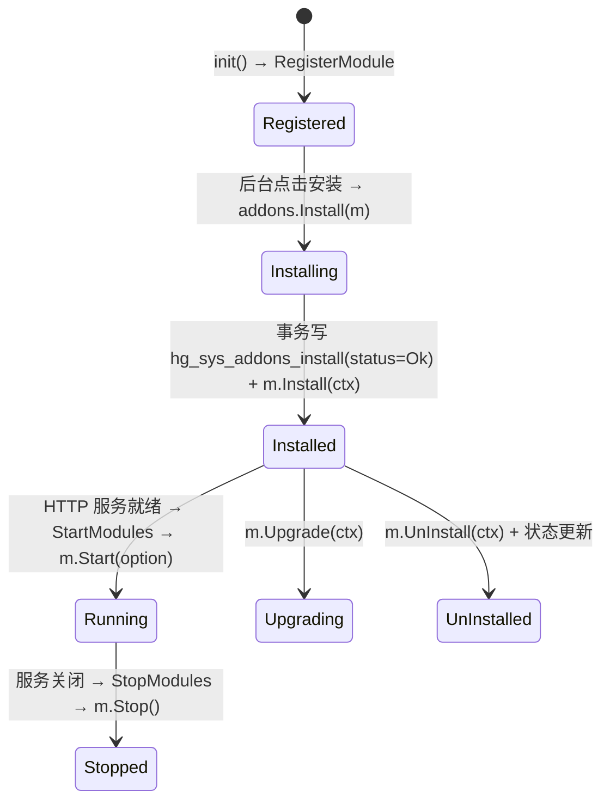

# 插件体系与代码生成

> 这是 HotGo 最具差异化的两块能力：**微核插件化** 与 **在线代码生成**。
> 配套阅读：[ARCHITECTURE-BACKEND.md](ARCHITECTURE-BACKEND.md) · [ARCHITECTURE-FRONTEND.md](ARCHITECTURE-FRONTEND.md) · [MODULES.md](MODULES.md) · [`docs/guide-zh-CN/addon-flow.md`](../docs/guide-zh-CN/addon-flow.md)

---

## 第一部分：插件（addons）

### 1.1 现状

| 项 | 内容 |
|----|------|
| 内置插件 | **仅 1 个**：`server/addons/hgexample/`（Label「功能案例」，Version `v1.0.0`），同时充当完整参考实现与演示集合 |
| 注册挂载点 | `server/addons/modules/`（每个插件一个 `.go`，内容仅一行匿名导入） |
| 数据结构 | 安装状态表 `hg_sys_addons_install`、配置表 `hg_sys_addons_config` |
| 后端核心库 | `server/internal/library/addons/`（`addons.go` / `module.go` / `install.go` / `build.go` / `build_layout.go`） |
| 前端目录 | `web/src/api/addons/<name>/`、`web/src/views/addons/<name>/` |
| 管理页面 | `web/src/views/develop/addons/`（列表 / 安装 / 升级 / 卸载 / 一键创建） |

> 注意：仓库中**不存在** `hgadmin`、`hgpay`、`hgblog` 等插件，README 中的"插件市场"能力由后台"创建新插件"功能提供。

### 1.2 目录结构（与主模块镜像）

```text
server/addons/<addonName>/
├── main.go                  # 插件入口：构造 Skeleton、实现 Module、init() 注册
├── global/{global.go,init.go}
├── api/{admin,api,home,websocket}/...
├── controller/{admin/sys,api,home,websocket}/...
├── logic/{logic.go, sys/<module>.go}
├── service/sys.go           # 插件独立 service 包
├── model/input/sysin/...
├── router/{admin.go,api.go,home.go,websocket.go,genrouter/{init.go,<module>.go}}
├── consts/                  # 插件常量与字典
├── crons/                   # 可选：插件定时任务
├── queues/                  # 可选：插件队列消费者
└── resource/                # 可选：插件静态资源与页面模板
```

对应前端：

```text
web/src/api/addons/<addonName>/...
web/src/views/addons/<addonName>/{index.vue,edit.vue,model.ts,config/...}
```

### 1.3 核心抽象（`library/addons`）

| 类型 | 说明 |
|------|------|
| `Skeleton` | 插件元信息：`Label/Name/Group/Logo/Brief/Description/Author/Version/RootPath`（`RootPath` 由 `RegisterModule` 自动注入为 `./addons/<name>`） |
| `Option` | 启动选项：`{ Server *ghttp.Server }` |
| `Module`（接口） | `Start(*Option)`、`Stop()`、`Ctx()`、`GetSkeleton()`、`Install(ctx)`、`Upgrade(ctx)`、`UnInstall(ctx)` |
| `RegisterModule(m)` | 写入模块表；**重名或 Skeleton 为空直接 panic** |
| `StartModules(ctx, option)` | 遍历"已安装"插件依次 `Start`，最后 `AddStaticPath` |
| `StopModules(ctx)` | 逐插件 `Stop`，失败仅告警 |
| `ModuleSelect()` | 输出 `form.Selects`，供生成器"选择插件"下拉使用 |

路径与前缀工具（`addons.go`）：

```go
GetResourcePath(ctx)                       // system.addonsResourcePath，默认 "resource"
GetModulePath(name)                        // ./addons/<name>
ViewPath(name, basePath)                   // <base>/addons/<name>/template
StaticPath(name, basePath)                 // URL /addons/<name>  →  <base>/addons/<name>/public
RouterPrefix(ctx, app, name)               // router.<app>.prefix + "/" + name
```

`RouterPrefix` 是**唯一合法的前缀来源**：`/admin/<name>`、`/api/<name>`、`/home/<name>`、`/socket/<name>`，禁止在路由文件里硬编码。

### 1.4 生命周期与安装态



- **安装态决定生死**：`filterInstalled()` 依赖 `IsInstall(m)`（`status == consts.AddonsInstallStatusOk`），未安装的插件不会被 `Start`，也不会挂载静态目录。
- `install.go` 的 `Install/Upgrade/UnInstall` 均为"**事务内先写安装表 → 再回调模块方法**"，重复安装/未安装会返回明确 `gerror`。
- 启动切入点：`internal/cmd/http.go` —— 服务就绪后 `addons.StartModules(ctx, &addons.Option{Server: s})`，关闭时 `addons.StopModules(ctx)`。

### 1.5 插件 `main.go` 模板

```go
package <addonName>

import (
    _ "hotgo/addons/<addonName>/crons"
    _ "hotgo/addons/<addonName>/queues"
    "hotgo/addons/<addonName>/global"
    _ "hotgo/addons/<addonName>/logic"
    "hotgo/addons/<addonName>/router"
    "hotgo/internal/library/addons"
    "hotgo/internal/service"
)

func init() { newModule() }

func newModule() {
    m := &module{
        skeleton: &addons.Skeleton{ Label: "插件显示名", Name: "<addonName>", /* Group/Brief/Author/Version ... */ },
        ctx: gctx.New(),
    }
    addons.RegisterModule(m)
}

func (m *module) Start(option *addons.Option) (err error) {
    global.Init(m.ctx, m.skeleton)
    option.Server.Group("/", func(group *ghttp.RouterGroup) {
        group.Middleware(service.Middleware().Addon)   // 关键：标记插件请求
        router.Admin(m.ctx, group)
        router.Api(m.ctx, group)
    })
    return
}
```

### 1.6 插件请求如何被识别

`internal/logic/middleware/init.go` 的两段逻辑：

1. `Ctx` 中间件为每个请求执行 `contexts.Init(r, &model.Context{ Module: getModule(r.URL.Path) })`，`getModule` 取路径第一段（`admin`/`api`/`home`/`socket`）；
2. `Addon` 中间件：剥掉 `/<module>/` 前缀后取下一段作为插件名 → `addons.GetModule(name)` → `contexts.SetAddonName(ctx, sk.Name)`。

判定 API 位于 `library/contexts/context.go`：`SetAddonName / GetAddonName / IsAddonRequest`。之后请求继续走该应用的鉴权中间件（如 `AdminAuth` → casbin），因此**插件天然继承主框架的认证/权限/日志体系**。

### 1.7 插件配置的读写

- 存储表 `hg_sys_addons_config`，服务实现 `internal/logic/sys/addons_config.go`：`GetConfigByGroup`、`UpdateConfigByGroup`（事务内按 key 更新）、`ConversionType`（按 `Type` 走 `consts.ConvType` 转换）。
- 插件侧入口 `addons/hgexample/logic/sys/config.go`：`GetBasic`、`GetConfigByGroup`、`UpdateConfigByGroup`。
- **解耦技巧**：插件 input 通过**嵌入**主模块 input 结构继承字段，避免 import cycle：

```go
// 插件 model/input/sysin/config.go
type UpdateConfigInp struct { sysin.UpdateAddonsConfigInp }

// 插件 logic
func (s *sSysConfig) UpdateConfigByGroup(ctx context.Context, in sysin.UpdateConfigInp) error {
    in.UpdateAddonsConfigInp.AddonName = global.GetSkeleton().Name
    return isc.SysAddonsConfig().UpdateConfigByGroup(ctx, in.UpdateAddonsConfigInp)
}
```

- **限制**：配置变量必须先在 `hg_sys_addons_config` 中存在，**不支持从前台新增变量**。

### 1.8 隔离边界

| 边界 | 机制 |
|------|------|
| 代码隔离 | 独立 `main.go/global/service/model/api/controller/logic/router`，包路径 `hotgo/addons/<name>/...` |
| 服务隔离 | 插件自带 `service` 包（`ISysConfig/ISysIndex/...` + `Register`），不与主模块 `service` 混用 |
| 调用主模块 | 以别名 `isc "hotgo/internal/service"` 调用主模块服务（单向依赖：插件 → 主模块） |
| 路由隔离 | 全部路由带 `/<addonName>` 段，前缀由 `addons.RouterPrefix` 生成 |
| 配置隔离 | 配置按 `addon + group` 分组存储 |
| 资源隔离 | 静态资源 `/addons/<name>/xxx` → `resource/addons/<name>/public/xxx`；模板 `resource/addons/<name>/template` |
| 数据表 | 约定 `addon_<name>_` 前缀（生成器会自动剥离该前缀作为模块名） |

### 1.9 一键创建插件（后台）

`internal/library/addons/build.go`：

- 入参 `BuildOption{ Skeleton, Config *model.BuildAddonConfig, Extend []string }`；
- 以 `Config.SrcPath`（默认 `resource/generate/default/addon`）为模板源，递归扫描后**去掉 `.template` 后缀**写入 `./addons/<name>/`；
- 模板变量替换：`@{.label} @{.name} @{.group} @{.brief} @{.description} @{.author} @{.version} @{.hgVersion}`；
- 同时生成：`addons/modules/<name>.go`（隐式注册）、前端 `web/src/api/addons/<name>/config/index.ts`、`web/src/views/addons/<name>/config/{BasicSetting.vue,system.vue}`；
- `checkBuildDir` 保证目标目录不存在，**避免覆盖既有插件**；
- 前端入口：`web/src/views/develop/addons/index.vue` → `POST /addons/build`；
- 相关配置：`config.yaml` 的 `hggen.addon.{srcPath,webApiPath,webViewsPath}`；内置骨架内容常量在 `build_layout.go`。

### 1.10 手工新增插件检查清单

**后端**

- [ ] `addons/<name>/main.go`（实现 `Module` + `init()` 注册）
- [ ] `addons/modules/<name>.go`（**必须**，仅 `import _ "hotgo/addons/<name>"`）
- [ ] `addons/<name>/global/{global.go,init.go}`
- [ ] `addons/<name>/service/sys.go`（接口 + Register）
- [ ] `addons/<name>/logic/logic.go`（匿名导入子包）
- [ ] `addons/<name>/logic/sys/<module>.go`
- [ ] `addons/<name>/model/input/sysin/<module>.go`
- [ ] `addons/<name>/api/admin/<module>/<module>.go`
- [ ] `addons/<name>/controller/admin/sys/<module>.go`
- [ ] `addons/<name>/router/admin.go`、`router/genrouter/init.go`、`router/genrouter/<module>.go`

**前端**

- [ ] `web/src/api/addons/<name>/index.ts`
- [ ] `web/src/views/addons/<name>/model.ts`、`index.vue`、`edit.vue`

**约束**

1. `Skeleton.Name` 必须与目录名、注册名一致；重名 / 空 Skeleton / 查不到模块都会 `panic`。
2. 插件路由前缀禁止硬编码，必须用 `addons.RouterPrefix(...)`。
3. 只有安装状态为 `Ok` 的插件才会启动。
4. 插件配置变量需先入库。
5. 插件 `genrouter.Register(ctx, group)` 与主模块入参不同（多 `ctx/group`），前缀取插件前缀。

---

## 第二部分：代码生成

### 2.1 模板资源

```text
server/resource/generate/default/
├── curd/                      # 业务 CRUD / 树表模板
│   ├── api.go.template            → api/admin/<mod>/<mod>.go
│   ├── controller.go.template     → internal/controller/admin/sys/<mod>.go
│   ├── input.go.template          → internal/model/input/sysin/<mod>.go
│   ├── logic.go.template          → internal/logic/sys/<mod>.go
│   ├── router.go.template         → internal/router/genrouter/<mod>.go
│   ├── source.sql.template        → 建表 SQL（MySQL）
│   ├── source_pgsql.sql.template  → 建表 SQL（PostgreSQL）
│   ├── web.api.ts.template        → web/src/api/<mod>/index.ts
│   ├── web.model.ts.template      → web/src/views/<mod>/model.ts
│   ├── web.index.vue.template     → web/src/views/<mod>/index.vue
│   ├── web.edit.vue.template      → web/src/views/<mod>/edit.vue
│   └── web.view.vue.template      → web/src/views/<mod>/view.vue
└── addon/                     # 插件脚手架模板（构建新插件用，见 1.9）
    ├── README.MD.template、main.go.template、consts/...
    ├── global/、logic/、model/、api/、controller/、router/、service/、crons/、queues/
    └── resource/{public/default.template, template/home/index.html}
```

> 插件模板（`curd` 模板中 `isAddon: true`）会把代码生成到 `server/addons/{$name}/...` 与 `web/src/{api,views}/addons/{$name}/...`，实现"业务代码直接长成插件"。

### 2.2 生成器实现

| 位置 | 作用 |
|------|------|
| `internal/library/hggen/hggen.go` | 对外 API：`Dao()`、`Service()`、`ServiceWithCfg()`、`TableColumns()`、`TableSelects()`、`GenTypeSelect()`、`DbSelect()`、`Preview()`、`Build()` |
| `internal/library/hggen/init.go` | `InIt(ctx)` 读取 `hack/config.yaml` 的 `gfcli.gen.dao/service` 配置（`GetDaoConfig(group)`、`GetServiceConfig()`） |
| `internal/library/hggen/views/` | 模板渲染与文件写出：`curd.go`（`DoPreview`/`DoBuild`、`CurdBuildEvent`）、`curd_generate_*.go`（api/input/controller/logic/router/web_*）、`column*.go`、`utils.go` |
| `internal/library/hggen/internal/cmd/` | 内嵌 GoFrame CLI 命令（`gendao`/`genservice`/`genctrl`），通过 `//go:linkname doGenDaoForArray` 直接调用 |
| `internal/logic/sys/gen_codes.go` | 服务入口 `sSysGenCodes`：`List/Edit/Status/Selects/TableSelect/ColumnSelect/ColumnList/Preview/Build` |
| `api/admin/gencodes/gencodes.go` | HTTP 契约：`/admin/genCodes/{list,view,edit,delete,maxSort,status,selects,tableSelect,columnSelect,columnList,preview,build}` |
| `internal/controller/admin/sys/gen_codes.go` | 薄控制器（透传） |
| 数据表 | `hg_sys_gen_codes`（`dao.SysGenCodes`） |

细节：`Dao()` 先把 DAO 生成到**临时目录**再 `gfile.CopyDir` 回项目，目的是**降低触发 GF 热编译的概率**。

### 2.3 生成流程

```mermaid
flowchart TD
  A[选择数据库 + 表] --> B[配置字段元数据]
  B --> C[预览代码]
  C --> D[提交生成]
  D --> E[保存配置 Status=Ok]
  E --> F[BeforeEvent: hggen.Dao 生成 dao/entity/do]
  F --> G[写 source.sql 并执行建表]
  G --> H[渲染并写出 api/input/controller/logic/router/web 文件]
  H --> I[AfterEvent: hggen.ServiceWithCfg 生成 service 接口]
  I --> J{isAddon?}
  J -->|是| K[gen service 源/目标指向 addons/name/{logic,service}]
  J -->|否| L[主模块 service]
```

1. **选表** `selects` / `tableSelect`：返回生成类型选项、数据库选项、状态/关联/构建方式/表单模式/字典/表格对齐/插件列表/树样式等；按库类型执行 SQL（MySQL `information_schema.TABLES` / PG `pg_class`）得到表、注释、`DefVarName/DefAlias/DaoName`（插件表自动剥离 `addon_<name>_`）；`hggen.disableTables` 过滤禁止生成的表。
2. **字段配置** `columnList` / `columnSelect`（MySQL `information_schema.COLUMNS` / PG `pg_attribute`），前端 `BaseInfo`、`EditMasterCell`、`EditSlaveCell` 编辑字段元数据。
3. **预览** `preview`：读系统配置 `GetLoadGenerate` → `views.Curd.DoPreview` → 依次生成 11 类文件内容。
4. **提交** `build`：先保存配置并置 `Status=GenCodesStatusOk` → `hggen.Build` → `views.Curd.DoBuild`（先 DAO、后建表、再写文件、最后 service）；失败置 `GenCodesStatusFail`。

所有输出路径来自配置 `config.yaml` 的 `hggen.application.{crud,queue,cron}` 与 `hggen.addon`；`views/utils.go` 的 `checkCurdPath` 负责把 `{$name}` 替换为插件名。

### 2.4 前端交互

- 页面：`web/src/views/develop/code/index.vue`（列表 + "立即生成"弹窗：生成类型 / 数据库 / 数据库表 / 生成模板 / 选择插件）。
- 配置容器：`views/develop/code/deploy.vue`（Tab：基本信息 / 主表字段 / 从表字段；按钮：返回列表 / 预览代码 / 提交生成 / 仅保存配置）。
- 子组件：`components/{BaseInfo,EditMasterCell,EditSlaveCell,PreviewTab,SetFuncDict,Move}.vue` + `model.ts`。
- API：`web/src/api/develop/code.ts`（`/genCodes/*`）。

### 2.5 支持的生成类型与现状

常量定义 `internal/consts/gencodes.go`：

| 类型 | 值 | 现状 |
|------|----|------|
| 增删改查列表 CURD | 10 | ✅ 已实现（`views.Curd`） |
| 关系树列表 Tree | 11 | ✅ 已实现（复用 CURD 引擎 + 树样式配置） |
| 队列消费者 Queue | 20 | ❌ 未实现（`hggen.Preview/Build` 返回"生成类型开发中！"） |
| 定时任务 Cron | 30 | ❌ 未实现（switch 未处理，返回"生成类型暂不支持！"） |

另有两类"生成"能力：

- **生成到插件目录**：`hggen` 模板配置中 `isAddon: true`（group `addon`）时，业务代码直接落到 `server/addons/{$name}/...` 与 `web/src/{api,views}/addons/{$name}/...`。
- **插件脚手架生成**：`internal/library/addons.Build`（见 1.9）。

**已知局限**：生成过程是**一次同步 HTTP 请求**，无 WebSocket 进度推送（`hggen` 内的 `progressbar` 仅用于 CLI 下载），大表生成时前端只能显示 loading。

---

## 第三部分：新增能力的完整路径

### 3.1 新增一个主模块 CRUD（推荐流程）

```text
1) 建表 SQL（或直接在后台"代码生成"里在线建表）
2) 后台 → 开发工具 → 代码生成：选库/选表 → 配置字段 → 预览 → 提交生成
3) 生成后按需微调：
   - internal/model/input/sysin/<mod>.go 的 Filter() 校验
   - internal/logic/sys/<mod>.go 的业务细节
   - web/src/views/<mod>/model.ts 的 schemas / columns
4) 在后台「菜单管理」新增菜单并配置权限标识（与接口路径一致）
5) 角色授权 → `make refresh` 刷新 casbin 策略（或在后台触发刷新）
```

手工方式（不依赖生成器）：参照 `MODULES.md` 第 1 节的"五后端 + 三前端"文件清单逐个创建即可，无需改动 `admin.go`（`genrouter/init.go` 的 `init()` 链会自动加载）。

### 3.2 新增一个插件

```text
1) 后台 → 插件管理 → 创建新插件（填名称/分组/作者/版本）→ 自动生成骨架 + 前端目录
   或：手工复制 server/resource/generate/default/addon 并替换 @{...} 变量
2) 确认 server/addons/modules/<name>.go 已生成（隐式注册）
3) 开发插件内的 api/controller/logic/service/model/router
4) 前端在 web/src/{api,views}/addons/<name>/ 下开发页面
5) 后台安装插件（写入 hg_sys_addons_install）→ 重启/热重载后插件路由生效
6) 插件配置变量先在 hg_sys_addons_config 中登记，再在插件 BasicSetting 页面读写
```

### 3.3 关键配置速查（`config.yaml`）

```yaml
hggen:
  allowedIPs: [...]          # 允许使用在线生成器的 IP
  selectDbs: [...]           # 可选择的数据库分组
  disableTables: [...]       # 禁止生成的表
  application:
    crud: { templates: [...] }   # CRUD 模板与目标路径（isAddon 决定是否生成到插件）
    queue: {...}                 # 规划中
    cron: {...}                  # 规划中
  addon:
    srcPath: resource/generate/default/addon   # 插件脚手架模板源
    webApiPath: ...            # 插件前端 api 生成路径
    webViewsPath: ...          # 插件前端 views 生成路径
```

---

## 相关文档

| 文档 | 内容 |
|------|------|
| [`docs/guide-zh-CN/addon-introduce-catalog.md`](../docs/guide-zh-CN/addon-introduce-catalog.md) | 插件目录介绍 |
| [`docs/guide-zh-CN/addon-flow.md`](../docs/guide-zh-CN/addon-flow.md) | 插件开发流程 |
| [`docs/guide-zh-CN/addon-helper.md`](../docs/guide-zh-CN/addon-helper.md) | 插件辅助说明 |
| [`docs/guide-zh-CN/code-curd.md`](../docs/guide-zh-CN/code-curd.md) / [`code-tree.md`](../docs/guide-zh-CN/code-tree.md) / [`code-curd-join.md`](../docs/guide-zh-CN/code-curd-join.md) | 生成 CURD / 树表 / 关联表 |
| [`docs/guide-zh-CN/code-template-dev.md`](../docs/guide-zh-CN/code-template-dev.md) | 自定义生成模板 |
| [`AGENTS.md`](../AGENTS.md) | 开发规范（插件与生成物必须对齐的编码约定） |
