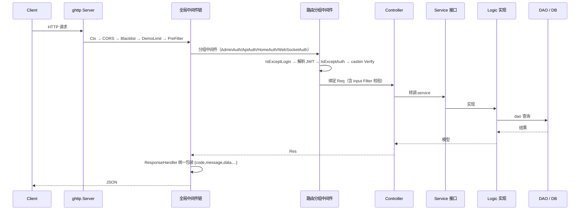

# 后端架构详解（server/）

> 目录：`server/`，module 名 `hotgo`，GoFrame v2.10.0，Go 1.24.4。
> 配套阅读：[PROJECT_ANALYSIS.md](PROJECT_ANALYSIS.md) · [MODULES.md](MODULES.md) · [ADDONS-AND-CODEGEN.md](ADDONS-AND-CODEGEN.md) · [AGENTS.md](../AGENTS.md)

---

## 1. 启动流程

### 1.1 入口 `server/main.go`

```go
import (
    _ "hotgo/internal/packed"                              // 静态资源（gres 打包产物）
    _ "github.com/gogf/gf/contrib/drivers/mysql/v2"        // MySQL 驱动
    _ "github.com/gogf/gf/contrib/drivers/pgsql/v2"        // PostgreSQL 驱动
    _ "github.com/gogf/gf/contrib/nosql/redis/v2"          // Redis 驱动
    _ "hotgo/addons/modules"                               // 插件隐式注册（每个插件一行 import）
    _ "hotgo/internal/logic"                               // 业务逻辑，触发所有 service.Register
)

func main() {
    ctx := gctx.GetInitCtx()
    global.Init(ctx)      // 全局初始化
    cmd.Main.Run(ctx)     // 命令分发
}
```

四个关键点：

- **`_ "hotgo/internal/logic"`**：`logic/logic.go` 匿名导入全部 logic 子包，各子包 `init()` 调用 `service.RegisterXxx()`，即可完成接口与实现绑定。
- **`_ "hotgo/addons/modules"`**：插件目录下每个插件一个文件，内容仅 `import _ "hotgo/addons/<name>"`，插件的 `main.go` 在 `init()` 中 `addons.RegisterModule(m)`。
- **`_ "hotgo/internal/packed"`**：`gf build` 时把 `server/resource` 打包进二进制，运行时以 gres 虚拟文件系统读取。
- **`global.Init(ctx)`**（`internal/global/init.go`）：设置 GF 运行模式、默认服务日志 Handler、时区 `Asia/Shanghai`、链路追踪、缓存适配器（`library/cache.SetAdapter`）、加载系统配置、加载超管信息、订阅集群同步。

### 1.2 命令树 `internal/cmd/`

| 命令 | 文件 | 作用 |
|------|------|------|
| `main` / `all` | `cmd.go` | **默认**。并发拉起 `http`+`queue`+`cron`（`simple.SafeGo`），并监听退出信号 |
| `http` | `http.go` | 启动 `ghttp` 服务器，绑定 Hook / 中间件 / 四组路由，启动插件、casbin、代码生成配置、TCP 服务、监控、黑名单、支付回调 |
| `queue` | `queue.go` | 匿名导入 `internal/queues` 并 `queue.StartConsumersListener(ctx)` |
| `cron` | `cron.go` | 匿名导入 `internal/crons`，`service.SysCron().StartCron(ctx)`，并以 `service.CronClient()` 长连接连主服务 |
| `auth` | `auth.go` | 授权/许可证校验相关（配合 `library/network/tcp` 的 AuthClient） |
| `tools` | `tools.go` | 工具命令：`-m=casbin -a1=refresh|clear` 刷新/清理权限等 |
| `up` | `up.go` | 在线升级（`gogf/selfupdate`），升级脚本在 `internal/cmd/upgrade/` |
| `help` | `cmd.go` | 帮助 |

`all` 模式的实现要点：HTTP / Queue / Cron 在**同一进程内**并发运行，任一协程 panic 由 `simple.SafeGo` 兜底，主 goroutine 等待信号后统一优雅退出（`handler_shutdown.go`）。

### 1.3 配置文件 `manifest/config/`

仓库仅提供 **`config.example.yaml`**，首次运行需复制为 `config.yaml`。另一个文件 `casbin.conf` 是 casbin 模型定义。

| 配置段 | 关键项 | 默认/说明 |
|--------|--------|-----------|
| `server` | `address` | `":8000"` |
| | `openapiPath` / `swaggerPath` | `/api.json` / `/swagger`（自动生成 API 文档） |
| | `serverRoot` | `resource/public` |
| | `clientMaxBodySize` | `200MB`（决定上传上限） |
| `database.default` | `link` | `mysql:hotgo:...@tcp(127.0.0.1:3306)/hotgo`，`Prefix: "hg_"` |
| `redis.default` | `address` / `db` | `127.0.0.1:6379`，db `2` |
| `token` | `secretKey` / `expires` / `autoRefresh` / `multiLogin` | JWT 密钥、有效期（默认 7 天）、自动续期、是否允许多端登录 |
| `cache` | `adapter` | `memory` \| `redis` \| `file`（默认 memory） |
| `queue` | `driver` | `disk` \| `redis` \| `rocketmq` \| `kafka` |
| `router.<app>` | `prefix` / `exceptLogin` / `exceptAuth` | 各应用前缀与白名单 |
| `tcp.server` / `tcp.client` | `address` / `appId` / `secretKey` | 内置 TCP 服务（默认 `:8099`），供 cron / auth 客户端连接 |
| `hggen` | `allowedIPs` / `selectDbs` / `disableTables` / `templates` / `addon` | 在线代码生成器配置（含 `application.crud/queue/cron` 模板与路径） |
| `system` | `mode` / `isDemo` / `isCluster` / `i18n` / `log` / `serveLog` / `addonsResourcePath` | 运行模式、演示模式、集群、国际化、日志开关 |
| `jaeger` | `switch` / `endpoint` | 链路追踪 |

---

## 2. 目录分层与职责

```text
server/
├── api/            # 对外 HTTP 契约（仅结构体 + g.Meta 路由声明）
│   ├── admin/      # 30 个后台模块：addons attachment blacklist cash common config creditslog cron
│   │               #   curddemo dept dict emslog gencodes log loginlog member menu monitor
│   │               #   normaltreedemo notice optiontreedemo order pay post provinces role
│   │               #   servelicense servelog smslog testcategory
│   ├── api/        # 前台接口契约（member、pay）
│   ├── home/       # 站点页面契约（base/site）
│   ├── websocket/  # WS 消息契约
│   └── servmsg/    # 内部 TCP 消息契约（auth / cron / example）
├── internal/
│   ├── controller/ # 薄控制器：admin/{admin,common,pay,sys}、api/、home/、websocket/
│   ├── service/    # 接口声明：sys.go / admin.go / common.go / pay.go / middleware.go / view.go
│   │               #   hook.go / tcpclient.go / tcpserver.go
│   ├── logic/      # 实现：sys/ admin/ common/ pay/ hook/ middleware/ tcpclient/ tcpserver/ view/
│   ├── dao/        # DAO（gf gen dao 生成）
│   ├── model/      # entity / do / input{adminin,sysin,commonin,payin,websocketin,form} / context / response / tree
│   ├── router/     # admin.go / api.go / home.go / websocket.go / genrouter/
│   ├── library/    # 22 个基础设施包（见第 7 节）
│   ├── consts/     # 常量与字典选项（30 个文件）
│   ├── global/     # 全局初始化、集群、路由元数据
│   ├── crons/      # 定时任务
│   ├── queues/     # 队列消费者
│   ├── websocket/  # WS 运行时
│   └── packed/     # 资源打包产物
├── addons/         # 插件（modules/ 注册入口 + hgexample/ 示例）
├── utility/        # 13 个工具包
├── resource/       # 代码生成模板 + 静态资源
├── storage/        # 初始化 SQL
└── manifest/       # 配置与 casbin 模型
```

### 分层规则（违反即返工）

| 层 | 允许 | 禁止 |
|----|------|------|
| `api` | `XxxReq` / `XxxRes` + `g.Meta` 路由标签、嵌入 `sysin.XxxInp` | 业务逻辑 |
| `controller` | 参数透传、空结果兜底、`PageRes.Pack` | 直接调 dao、写业务逻辑 |
| `service` | 接口声明 + `RegisterXxx()` | 具体实现 |
| `logic` | 业务实现、`dao.XxxTable.Columns().Field`、调其它 service | HTTP 相关代码、重复校验（校验在 input 的 `Filter()`） |
| `dao` | 查询构建 | 手改 `internal/dao/internal/`（CLI 生成） |

---

## 3. 请求生命周期



### 全局中间件链（`internal/cmd/http.go` 注册顺序，顺序不可随意调整）

| 顺序 | 中间件 | 职责 |
|------|--------|------|
| 1 | `Ctx` | **必须最先**：初始化上下文（`contexts.Init`，含 `Module` 识别）、国际化、链路追踪 |
| 2 | `CORS` | 跨域 |
| 3 | `Blacklist` | IP 黑名单拦截 |
| 4 | `DemoLimit` | 演示模式拦截写操作（POST/PUT/DELETE） |
| 5 | `PreFilter` | 入参预处理（统一 `Filter` 管道） |
| 6 | `ResponseHandler` | 统一响应体格式化 |

此外通过 `s.BindHook(service.Hook())` 注册 `BeforeServe` / `AfterOutput`：前者做访问日志/参数快照，后者做响应日志与操作日志入库（`internal/logic/hook/`）。

### 鉴权链路（以 admin 为例）

`internal/logic/middleware/admin_auth.go`：

1. **登录白名单**：命中 `router.admin.exceptLogin`（如 `/admin/site/login`）→ 直接放行；
2. **解析身份**：`token.ParseLoginUser(r)`（`library/token`，HS256 + cache 存储）→ `contexts.SetUser()` / `AdminSite().BindUserContext()`，失败返回未授权；
3. **权限白名单**：命中 `router.admin.exceptAuth` → 放行；
4. **Casbin 校验**：`service.AdminRole().Verify(ctx, path, method)`；
5. 未命中记录登录日志/操作日志。

Casbin 策略来源（`library/casbin/enforcer.go` 的 `loadPermissions`）：`admin_role.key` ⨝ `admin_role_menu` ⨝ `admin_menu.permissions`，排除超管角色后 `AddPolicies` 到 Enforcer；模型文件 `manifest/config/casbin.conf`。角色/菜单变更后需刷新：`make refresh` 或 `go run main.go tools -m=casbin -a1=refresh`。

### 上下文对象 `library/contexts`

`contexts.Init(r, &model.Context{...})` 为每个请求维护：`User *model.Identity`（含 `Id/RoleKey/...`）、`Module`（admin/api/home/socket）、`AddonName`、`Response`、`Data`。常用 API：`SetUser/GetUserId/GetRoleKey`、`GetModule`、`SetAddonName/IsAddonRequest`、`SetResponse`。

---

## 4. 路由注册机制

### 4.1 注册入口

`internal/cmd/http.go` 中：

```go
s.Group("/", func(group *ghttp.RouterGroup) {
    router.Admin(ctx, group)      // /admin
    router.Api(ctx, group)        // /api
    router.WebSocket(ctx, group)  // /socket
    router.Home(ctx, group)       // /home 与 /
})
```

### 4.2 各路由文件

| 文件 | 前缀 | 关键动作 |
|------|------|----------|
| `router/admin.go` | `/admin`(`router.admin.prefix`) | 先 `group.Bind(common.Site)`（免登录：验证码、登录、配置等）→ 挂 `AdminAuth` → 绑定 `sys.* / admin.* / pay.Refund` → 挂 `Develop`（开发工具：GenCodes、Addons）→ 末行 `genrouter.Register(ctx, group)` |
| `router/api.go` | `/api` | 先绑定 `pay.NewV1()`（支付异步通知，免登录）→ 挂 `ApiAuth` → 绑定 `member.NewV1()` |
| `router/home.go` | `/home` 与 `/` | 挂 `HomeAuth` → 绑定 `base.Site`（页面渲染） |
| `router/websocket.go` | `/socket` | `controller.Send`（HTTP 方式向 WS 推送消息）→ 挂 `WebSocketAuth` → `GET /` 绑定 `websocket.WsPage`；随后 `websocket.Start()` 并 `websocket.RegisterMsg(...)` 注册事件（ping/join/quit/admin/monitor/*） |

### 4.3 `genrouter`：代码生成模块的路由挂载点

`internal/router/genrouter/init.go` 暴露两个全局切片：

```go
var (
    NoLoginRouter       []interface{} // 免登录路由
    LoginRequiredRouter []interface{} // 需登录路由
)

func Register(ctx context.Context, group *ghttp.RouterGroup) {
    prefix := simple.RouterPrefix(ctx, consts.AppAdmin)     // /admin
    group.Group(prefix, func(group *ghttp.RouterGroup) {
        group.Bind(NoLoginRouter...)
        group.Middleware(service.Middleware().AdminAuth)
        group.Bind(LoginRequiredRouter...)
    })
}
```

在线代码生成器在生成模块时，自动在 `genrouter/` 下写入 `<module>.go`：

```go
func init() { LoginRequiredRouter = append(LoginRequiredRouter, sys.XxxModule) }
```

由于 `init()` 链的存在，**新增生成模块无需修改任何既有文件**。当前已有示例：`curd_demo.go`、`normal_tree_demo.go`、`option_tree_demo.go`、`test_category.go`。

> 插件版 `genrouter` 的区别：`Register(ctx, group)` 使用 `addons.RouterPrefix(ctx, consts.AppAdmin, global.GetSkeleton().Name)`，前缀形如 `/admin/<addonName>`。

### 4.4 API 文档自动化

GoFrame 依据 `api` 层结构体上的 `g.Meta`（`path/method/tags/summary`）自动生成 OpenAPI：`/api.json`、`/swagger`。**这是"无需注解写文档"的关键机制——契约即文档。**

---

## 5. 多应用入口

常量定义 `internal/consts/app.go`：

```go
AppAdmin = "admin"; AppApi = "api"; AppHome = "home"; AppWebSocket = "websocket"; AppDefault = "default"
```

| 应用 | 前缀（可配置） | 路由文件 | 控制器 | API 契约 | 鉴权中间件 |
|------|---------------|----------|--------|----------|-----------|
| admin（后台） | `/admin` | `router/admin.go` | `controller/admin/{admin,common,pay,sys}` | `api/admin/*` | `AdminAuth` + `Develop` |
| api（前台接口） | `/api` | `router/api.go` | `controller/api/{member,pay}` | `api/api/*` | `ApiAuth` |
| home（站点页面） | `/home`、`/` | `router/home.go` | `controller/home/base` | `api/home/*` | `HomeAuth` |
| websocket（通讯） | `/socket` | `router/websocket.go` | `controller/websocket/*` | `api/websocket/*` | `WebSocketAuth` |
| servmsg（内部 TCP） | — | — | — | `api/servmsg/{auth,cron,example}` | TCP 层自身认证 |

---

## 6. 定时任务与消息队列

### 6.1 定时任务 `crons`

- **核心库** `library/cron`：接口 `Cron{ GetName() string; Execute(ctx, *Parser) }`，`Register(...)` 注册，`StartCron` 基于 GoFrame `gcron` 调度；策略常量在 `consts/cron.go`：`CronPolicySame`（并行）/`Single`（单例）/`Once`（单次）/`Times`（多次），参数以 `,` 分隔。支持 `StartALL/StopALL/Start/Stop/Delete/Once/RefreshStatus`，每个任务独立日志。
- **任务来源**：表 `hg_sys_cron`（后台可视化增删改启停），任务代码需在 `internal/crons/` 中实现并注册。现有：`close_order.go`（关闭过期订单）、`test.go`、`test2.go`。
- **注册方式**：`internal/crons/*.go` 的 `init()` 调用 `cron.Register(Xxx)`；`internal/cmd/cron.go` 匿名导入该包激活。
- **独立进程模式**：`cron` 命令通过 `service.CronClient()` 与主服务（http）建立 TCP 长连接，从而支持"后台动态管理任务、cron 进程执行"的部署形态。

### 6.2 消息队列 `queues`

- **核心库** `library/queue`：接口 `MqProducer` / `MqConsumer`，`RegisterConsumer` / `Push(topic, data)`；驱动实现：`disk`（磁盘队列）、`redis`（redismq）、`rocketmq`、`kafka`；配置项 `queue.driver` 切换。
- **消费者**：`internal/queues/*.go` 的 `init()` 调用 `queue.RegisterConsumer(...)`，按 `GetTopic()` 分发。现有：`login_log.go`、`serve_log.go`、`sys_log.go`。
- **主题常量** `consts/queue.go`：`QueueLogTopic="request_log"`、`QueueLoginLogTopic="login_log"`、`QueueServeLogTopic="serve_log"`。
- **触发方式**：日志类中间件/Hook（`logic/hook/access_log.go`、`global/init.go`）在队列开关开启时 `queue.Push(topic, data)`，否则直接写库，实现"重负载异步化"。

---

## 7. 基础设施库 `internal/library`（22 个包）

| 包 | 能力 | 驱动 / 后端 |
|----|------|-------------|
| `addons` | 插件框架：`Skeleton/Module/Option`、`RegisterModule`、`StartModules/StopModules`、`Build`（脚手架）、`Install/Upgrade/UnInstall`、`RouterPrefix`、静态/模板路径 | — |
| `cache` | `Instance() *gcache.Cache`、`SetAdapter(ctx)`，并同步注入 `g.DB().GetCache()` | `memory` / `redis` / `file` |
| `captcha` | 图形验证码 `Generate/Verify`（`base64Captcha`，算术/字符） | 内存 store |
| `casbin` | 权限引擎：gdb Adapter + `InitEnforcer`、`Clear`、`Refresh`、`loadPermissions` | 策略源：角色-菜单-权限表 |
| `contexts` | 请求上下文：用户身份、Module、AddonName、Response、Data | — |
| `cron` | 定时任务框架（注册表、调度、策略、日志、`cron_gen.go`） | GoFrame `gcron` |
| `debris` | 空占位包（无实际能力，建议清理） | — |
| `dict` | 枚举字典 + 方法字典：`RegisterEnums`、`RegisterFunc`、`GetOptions`、`GetOptionLabel`、`GenIdHash` | 内存 + 缓存 |
| `ems` | 邮件发送（SMTP，HTML） | — |
| `hggen` | 在线代码生成器（内嵌 `gf gen dao/service/ctrl` + 模板渲染） | MySQL / PostgreSQL |
| `hgorm` | ORM 增强：`LeftJoin`、`GenJoinSelect`、`GetPkField`、`IsUnique`、`FilterKeywordsWithOr`、树形 `dao_tree`、租户 `dao_tenant`；`handler/`（FilterAuth、ForceCache、Sorter、Tenant）、`hook/`（member、provinces、tenant） | — |
| `hgrds` | Redis 增强：`lock`（分布式锁 + 看门狗续期）、`pubsub`（发布订阅，用于集群同步） | Redis |
| `location` | IP 归属地 / 地理编码 / 行政区划，带缓存 | whois、cz88 |
| `network` | TCP 长连接框架：`Client`/`Server`/`Conn`/`MsgParser`/`Router`/`RPC`，含 cron/auth 专用客户端 | gtcp |
| `payment` | 支付网关抽象 `PayClient{CreateOrder/Notify/Refund}`、`New(name)`、`Gen*Sn`、`notifycall.go` | `alipay` / `wxpay` / `qqpay` |
| `queue` | 消息队列抽象 `MqProducer`/`MqConsumer` | `disk` / `redis` / `rocketmq` / `kafka` |
| `response` | 统一响应 `JsonExit/RJson/RXml/CustomJson/Redirect/RText`，写回 `model.Response{Code,Message,Data,Error,Timestamp,TraceID}` | — |
| `sms` | 短信驱动 `Drive.SendCode`、`New(name)` | `AliYun` / `Tencent` |
| `storager` | 上传：`UploadDrive{Upload/CreateMultipart/UploadPart}`、`DoUpload`、秒传（MD5 复用）、分片上传、MIME | `local` / `ucloud` / `cos` / `oss` / `qiniu` / `minio` |
| `token` | 登录令牌：`Login/Logout/ParseLoginUser`、`Claims`(=`model.Identity`+JWT 标准声明)、多端登录控制、自动续期 | JWT HS256 + cache |
| `validate` | YAML 校验工具：`IsValidYAML/ValidateYAML/ParseYAML/ToYAML` | — |
| `wechat` | 微信公众号网页授权：`GetOauthURL/GetUserInfo/GetUserAccessToken`、配置与缓存 | `silenceper/wechat/v2` |

> 注意：`pay`/`storage` 在本仓库的实际包名是 `payment`/`storager`；`notify`、`ipc` 不存在；`blacklist` 是业务模块（`logic/sys/blacklist.go`），`excel` 在 `utility/excel`。

---

## 8. 通用工具包 `server/utility`（13 个包）

| 包 | 代表性能力 |
|----|-----------|
| `charset` | `RandomCreateBytes`、错误堆栈 `ParseErrStack/SerializeStack`、`SubstrAfter` |
| `convert` | 泛型/反射转换：`GetModelTable`、`EscapeFieldsToSlice`、驼峰↔下划线、实体 tag 提取（`GetEntityFieldTags/GetEntityDescTags`）、IP 策略解析、切片去重/差集 |
| `db` | 表与字段注释获取（MySQL `information_schema`、SQLite 补全）、跨库引号适配（`GetQuoteChar/QuoteIdentifier/QuoteField`） |
| `encrypt` | `Md5/Md5ToString/Hash32`、AES(ECB) 加解密（配合 `simple.DecryptText`） |
| `excel` | 基于 `excelize/v2` 的结构体切片导出 xlsx（样式、列宽、下载响应头） |
| `file` | 目录遍历/大小、路径拼接、构造 `multipart.FileHeader` |
| `format` | `Round2*`、`FileSize`、`AgoTime`（"多久以前"） |
| `simple` | 通用杂项：`RouterPrefix`、`SafeGo`、`Logf`、`DecryptText`、`CheckPassword`、`GetHeaderLocale`、演示掩码 `FilterMaskDemo`；事件总线 `Event().Register/Call/Remove/Clear`；系统配置读取 |
| `tree` | 关系树生成 `GenTree/GenTreeWithField/GenLabel/GetIds/GetMinPid`，泛型 `ListToTree` |
| `url` | URL 参数 ↔ map、`GetAddr/GetDomain` |
| `useragent` | UA 解析（OS、浏览器、设备），配合移动端判断 |
| `validate` | 通用校验：`IsEmail/IsMobile/IsIp/IsPublicIp/IsLocalIPAddr/IsHTTPS/IsWXVisit...`；`Filter` 接口 + `PreFilter`（input 层统一预过滤） |

---

## 9. DAO / Model / Service 的生成

### 9.1 离线（命令行）

配置 `server/hack/config.yaml`（gf CLI 项目级配置）：

- `gfcli.gen.dao`：数据库 link、`removePrefix: "hg_"`、`jsonCase: "CamelLower"`、`tablesEx` 排除表；
- `gfcli.gen.ctrl`：由 `api/api` 自动生成 `internal/controller/api`；
- `gfcli.build`：编译名、目标平台、`packSrc: "resource"`、`packDst: "internal/packed/packed.go"`。

执行：`make dao`（`gf gen dao`）、`make service`（`gf gen service`）。

产物：`internal/dao/*`、`internal/model/entity/*`、`internal/model/do/*`、`internal/service/*.go`。**`internal/dao/internal/`、`model/entity`、`model/do` 均为生成物，禁止手改。**

### 9.2 在线（后台可视化）

`internal/library/hggen` 封装了 GF CLI 的 `gendao`/`genservice`/`genctrl`（通过 `//go:linkname` 直接调用）与模板渲染，启动时非生产模式执行 `hggen.InIt(ctx)`。详见 [ADDONS-AND-CODEGEN.md](ADDONS-AND-CODEGEN.md)。

---

## 10. WebSocket 与 TCP

| 能力 | 位置 | 要点 |
|------|------|------|
| WebSocket 服务端 | `internal/websocket` + `api/websocket` | `WsPage` 升级连接；`Start()` 启动运行时；`RegisterMsg(...)` 注册事件处理器（ping/join/quit/admin/monitor/*）；连接元数据与消息路由集中在 `internal/websocket` |
| 向在线用户推送 | `controller/websocket/send.go` + `/socket/send` | 通过 HTTP 接口触发向指定用户/全员推送（业务侧调用） |
| TCP 服务端 | `library/network` + `logic/tcpserver` | 长连接、断线重连、服务认证、路由分发、RPC 消息、拦截器、数据绑定；默认 `:8099` |
| TCP 客户端 | `logic/tcpclient`（`IAuthClient` / `ICronClient`） | 授权校验与定时任务进程与主服务通讯 |

---

## 11. 后端可扩展点速查

| 我要做的事 | 需要改动的文件 |
|------------|----------------|
| 新增一个后台 CRUD 接口 | `api/admin/<mod>/*.go` → `internal/model/input/sysin/<mod>.go` → `internal/controller/admin/sys/<mod>.go` → `internal/service/sys.go`（追加接口）→ `internal/logic/sys/<mod>.go` → `internal/router/genrouter/<mod>.go` |
| 新增一个定时任务 | `internal/crons/<task>.go`（`init()` 中 `cron.Register`）+ 后台任务表配置 |
| 新增一个队列消费者 | `internal/queues/<name>.go`（`init()` 中 `queue.RegisterConsumer`）+ `consts/queue.go` 主题常量 |
| 新增一个字典 | `internal/consts/<x>.go` 定义常量与 `Options`，`init()` 中 `dict.RegisterEnums` |
| 新增一个中间件 | `internal/service/middleware.go` 追加接口 → `internal/logic/middleware/<x>.go` 实现 → 在 `cmd/http.go` 或对应 `router/*.go` 挂载 |
| 新增一个插件 | 见 [ADDONS-AND-CODEGEN.md](ADDONS-AND-CODEGEN.md) |
| 新增一个应用入口 | `consts/app.go` 增加常量 + 配置 `router.<app>.prefix` + `internal/router/<app>.go` + `cmd/http.go` 注册 |
