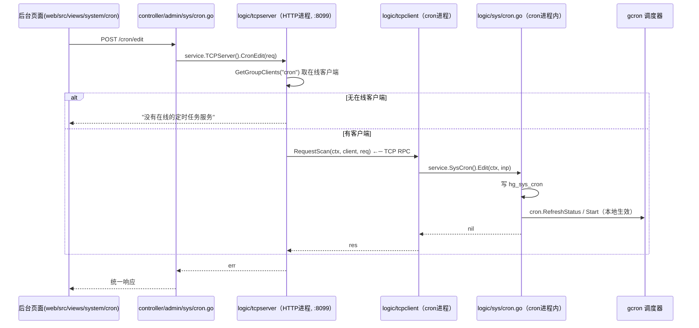

# HotGo 定时任务与消息队列 · 实现剖析与选型对比

> **文档定位**：从源码层面说明 HotGo 的「定时任务」与「消息队列」两套异步基础设施如何实现、如何配置、如何扩展，并给出定时任务调度库的选型对比。
>
> **来源与口径**：以仓库源码为准（`server/` 实测），GoFrame 部分以本地源码 `github.com/gogf/gf/v2@v2.10.0` 为权威依据，robfig/cron 部分核对本地 `robfig/cron@v1.2.0`，v3 独有能力单独标注。凡文档与源码冲突处以源码为准。
>
> **关联文档**：[`ARCHITECTURE-BACKEND.md`](ARCHITECTURE-BACKEND.md)（分层与启动）、[`GOFRAME-GUIDE.md`](GOFRAME-GUIDE.md)（框架组件）、[`MODULES.md`](MODULES.md)（业务模块）

---

## 0. 一页速查

| 维度 | 定时任务 | 消息队列 |
|------|----------|----------|
| 底层实现 | **GoFrame `os/gcron`**（无第三方） | **HotGo 自研适配层**（无第三方 MQ SDK 之外的东西） |
| 依赖引入 | 已在框架依赖树内 | `rocketmq-client-go` / `sarama`（按驱动） |
| 驱动/后端 | 单一实现（gcron） | `disk` / `redis` / `rocketmq` / `kafka` |
| 配置存放 | **数据库表** `hg_sys_cron` | **配置文件** `queue` 段 |
| 是否有管理界面 | ✅ 后台「定时任务」页 | ❌ 仅配置 + 日志 |
| 独立进程 | ✅ `cron` 命令 | ✅ `queue` 命令 |
| 动态生效 | ✅ 通过内置 TCP RPC（`:8099`） | ❌ 改配置需重启 |
| 任务/消息注册方式 | `cron.Register()` + `init()` | `queue.RegisterConsumer()` + `init()` |
| 隐式激活 | `internal/cmd/cron.go` 匿名 import `internal/crons` | `internal/cmd/queue.go` 匿名 import `internal/queues` |
| 独立日志通道 | `g.Log("cron")`，按任务 SN 分子目录 | `queue.Logger()` |
| 代码生成支持 | ❌ `Cron(30)` 未实现 | ❌ `Queue(20)` 未实现 |

**一句话**：两者都是「**框架/自研库 + 独立进程 + `init()` 隐式注册 + 独立日志通道**」的同构设计，区别在于定时任务的**任务属性放数据库并由 TCP RPC 动态下发**，而队列**驱动参数放配置文件、只能重启生效**。

---

## 1. 定时任务（Cron）

### 1.1 用什么库

**`github.com/gogf/gf/v2/os/gcron`** —— GoFrame 自带的定时任务模块。`go list -m all` 确认本项目依赖树中**没有任何 cron 相关第三方模块**（无 `robfig/cron`、无 `gocron`）。

全仓 6 处引用 gcron：

| 位置 | 用途 | 是否业务任务 |
|------|------|--------------|
| `internal/library/cron/cron.go` | 业务定时任务的调度封装 | ✅ 核心 |
| `internal/library/network/tcp/client_cron.go` | TCP 客户端心跳（`@every 300s` 心跳 / `@every 600s` 超时检查） | ❌ 框架内部 |
| `internal/library/network/tcp/server_cron.go` | TCP 服务端侧定时清理 | ❌ 框架内部 |
| `internal/logic/common/wechat.go` | 微信 access_token 刷新 | ❌ 框架内部 |
| `internal/logic/admin/monitor.go` | 服务器监控数据采集 | ❌ 框架内部 |
| `internal/websocket/client_manager.go` | WebSocket 客户端清理 | ❌ 框架内部 |

> **要点**：后 4 处是"框架内部用 gcron 起后台循环"，**不出现在后台「定时任务」列表里**，也不受数据库配置控制。排查"为什么有个任务在跑但后台看不到"时先看这里。

### 1.2 三层架构总览

```
┌─────────────────────────────────────────────────────────────────┐
│ ① 任务定义层   server/internal/crons/*.go                        │
│    实现 cron.Cron 接口（GetName + Execute），init() 隐式注册       │
│    经 `_ "hotgo/internal/crons"` 激活                             │
└────────────────────────────┬────────────────────────────────────┘
                             │ cron.Register()
┌────────────────────────────▼────────────────────────────────────┐
│ ② 调度封装层   server/internal/library/cron/                      │
│    cronManager{tasks, loggers, RWMutex} → 映射到 gcron            │
│    Register / StartALL / Start / Stop / Delete / Once /          │
│    RefreshStatus / DispatchLog                                   │
└────────────────────────────┬────────────────────────────────────┘
                             │ 任务属性（表达式/策略/参数/启停）
┌────────────────────────────▼────────────────────────────────────┐
│ ③ 配置来源   MySQL 表 hg_sys_cron（+ hg_sys_cron_group）          │
│    后台页面维护 → TCP RPC → cron 进程写库并改调度器                │
└─────────────────────────────────────────────────────────────────┘
```

### 1.3 任务定义层

**接口契约**（`internal/library/cron/cron.go:33-45`）：

```go
// Cron 定时任务接口
type Cron interface {
	// GetName 获取任务名称
	GetName() string
	// Execute 执行任务
	Execute(ctx context.Context, parser *Parser) (err error)
}

// Parser 任务执行参数
type Parser struct {
	Args   []string     // 任务参数
	Logger *glog.Logger // 日志管理实例
}
```

**两个示例**：

```go
// 无参数任务：server/internal/crons/test.go
func init() {
	cron.Register(Test)
}

var Test = &cTest{name: "test"}

func (c *cTest) GetName() string { return c.name }

func (c *cTest) Execute(ctx context.Context, parser *cron.Parser) (err error) {
	parser.Logger.Infof(ctx, "cron test Execute:%v", time.Now())
	return
}
```

```go
// 真实业务任务：server/internal/crons/close_order.go（关闭过期订单）
func init() {
	cron.Register(CloseOrder)
}

var CloseOrder = &cCloseOrder{name: "close_order"}

func (c *cCloseOrder) Execute(ctx context.Context, parser *cron.Parser) (err error) {
	_, err = service.AdminOrder().Model(ctx).
		Where(dao.AdminOrder.Columns().Status, consts.OrderStatusNotPay).
		WhereLTE(dao.AdminOrder.Columns().CreatedAt, gtime.Now().AddDate(0, 0, -1)).
		Data(g.Map{dao.AdminOrder.Columns().Status: consts.OrderStatusClose}).
		Update()
	if err != nil {
		parser.Logger.Warning(ctx, "cron CloseOrder Execute err:%+v", err)
	}
	return
}
```

**注册机制**（`cron.go:74-86`）：

```go
// Register 注册任务
func Register(c Cron) {
	crons.Lock()
	defer crons.Unlock()

	name := c.GetName()
	if _, ok := crons.tasks[name]; ok {
		Logger().Debugf(gctx.GetInitCtx(), "cron.Register name:%v duplicate registration.", name)
		return
	}

	crons.tasks[name] = &TaskItem{Name: c.GetName(), Fun: GenExecuteFun(c.Execute)}
}
```

- 注册只是往包级 map 塞一条记录（`Fun` 已被包装成 `gcron.JobFunc`），**此时还没有任何调度发生**；
- **重名只打 Debug 日志，静默忽略**（后注册者不生效）；
- 必须靠 `internal/cmd/cron.go:11` 的 `_ "hotgo/internal/crons"` 触发包的 `init()`。

### 1.4 调度封装层

**数据结构**（`cron.go:28-68`）：

```go
var crons = &cronManager{
	tasks:   make(map[string]*TaskItem),
	loggers: make(map[string]*glog.Logger),
}

type cronManager struct {
	tasks   map[string]*TaskItem
	loggers map[string]*glog.Logger
	sync.RWMutex
}

type TaskItem struct {
	Pattern string        // 表达式
	Name    string        // 唯一的任务名称
	Params  string        // 函数参数，多个用,隔开
	Fun     gcron.JobFunc // 执行的函数接口
	Policy  int64         // 策略 1：并行 2：单例 3：单次 4：多次
	Count   int           // 执行次数，仅Policy=4时有效
}
```

**对外 API 全表**：

| 函数 | 语义 | 关键实现点 |
|------|------|-----------|
| `Register(c Cron)` | 注册任务定义 | 重名静默忽略 |
| `StartALL(sysCron []*entity.SysCron)` | 批量启动（启动期主入口） | 幂等；见下方详解 |
| `Start(sysCron)` | 启动单个任务 | `gcron.Search(sn)` 命中则只 `Start`，否则委托 `StartALL` |
| `Stop(sysCron)` | 停止单个任务 | `Search` + `Entry.Stop()` |
| `ResetStart(sysCron)` | 重置 = `Stop` + `Delete` + `Start` | 改表达式后必须走这条 |
| `Delete(sysCron)` | 从调度器移除 | 遍历 `gcron.Entries()` 按 SN 匹配后 `Remove` |
| `RefreshStatus(sysCron)` | 按状态启停 | `status == enabled` → `ResetStart`，否则 `Stop` |
| `Once(ctx, sysCron)` | 立即执行一次 | `simple.SafeGo` 异步，**不校验是否启用** |
| `StopALL()` | 停止全部 | 遍历 `gcron.Entries()` 逐个 `Remove` |
| `DispatchLog(sysCron)` | 读取调度日志 | 见 §1.8 |
| `Logger()` | 任务专用 logger | `g.Log("cron")` |

**`StartALL` 的完整逻辑**（`cron.go:96-160`，本模块最需要读懂的一段）：

```go
func StartALL(sysCron []*entity.SysCron) (err error) {
	crons.Lock()
	defer crons.Unlock()

	if len(crons.tasks) == 0 {
		g.Log().Debug(gctx.GetInitCtx(), "no scheduled task is available.")
		return
	}

	for _, cron := range sysCron {
		f, ok := crons.tasks[cron.Name]
		if !ok {
			return gerror.Newf("该任务没有加入任务列表:%v", cron.Name)   // ← 注意：直接 return，中断整个循环
		}

		sn := GenCronSn(cron)

		// 没有则添加
		if gcron.Search(sn) == nil {
			var (
				t   *gcron.Entry
				ctx = GenCronCtx(cron)
			)
			switch cron.Policy {
			case consts.CronPolicySame:
				t, err = gcron.Add(ctx, cron.Pattern, f.Fun, sn)
			case consts.CronPolicySingle:
				t, err = gcron.AddSingleton(ctx, cron.Pattern, f.Fun, sn)
			case consts.CronPolicyOnce:
				t, err = gcron.AddOnce(ctx, cron.Pattern, f.Fun, sn)
			case consts.CronPolicyTimes:
				if f.Count <= 0 {
					f.Count = 1
				}
				t, err = gcron.AddTimes(ctx, cron.Pattern, int(cron.Count), f.Fun, sn)
			default:
				return gerror.Newf("使用无效的策略, cron.Policy=%v", cron.Policy)
			}
			if err != nil {
				return err
			}
			if t == nil {
				return gerror.New("启动任务失败")
			}
		}

		gcron.Start(sn)

		// 执行完毕，单次和多次执行的任务更新状态
		if cron.Policy == consts.CronPolicyOnce || cron.Policy == consts.CronPolicyTimes {
			if _, err = dao.SysCron.Ctx(gctx.GetInitCtx()).Where(dao.SysCron.Columns().Id, cron.Id).
				Data(g.Map{
					dao.SysCron.Columns().Status:    consts.StatusDisable,
					dao.SysCron.Columns().UpdatedAt: gtime.Now(),
				}).Update(); err != nil {
				err = gerror.Wrap(err, "定时任务执行失败！")
				return err
			}
		}
	}
	return nil
}
```

**策略 ↔ gcron 方法映射**（`internal/consts/cron.go`）：

| 常量 | 值 | gcron 方法 | 语义 |
|------|----|-----------|------|
| `CronPolicySame` | 1 | `gcron.Add` | 并行：上次未跑完也照常触发 |
| `CronPolicySingle` | 2 | `gcron.AddSingleton` | 单例：上次未跑完则跳过本次 |
| `CronPolicyOnce` | 3 | `gcron.AddOnce` | 只执行一次 |
| `CronPolicyTimes` | 4 | `gcron.AddTimes(pattern, count, ...)` | 执行 N 次 |

> **两个隐含行为**：
> 1. **幂等启动**：`gcron.Search(sn) == nil` 才创建，重复调用 `StartALL` 不会重复注册；已经在跑的 entry 只是被再次 `Start()`。
> 2. **单次/多次策略启动后立即把 DB `status` 置为禁用**——这是设计行为，避免进程重启后历史任务被反复拉起。

### 1.5 配置来源：两张数据库表

**`entity.SysCron`**（`internal/model/entity/sys_cron.go`）：

| 字段 | 含义 | 关键约束 |
|------|------|----------|
| `Id` | 任务 ID | 与 `Name` 拼成调度器条目名 `name@id` |
| `GroupId` | 分组 ID | 关联 `hg_sys_cron_group`，仅用于展示归类 |
| `Title` | 任务标题 | 仅展示 |
| **`Name`** | **任务方法名** | **必须与代码 `GetName()` 完全一致**，对不上则 `StartALL` 报 `该任务没有加入任务列表:xxx` |
| `Params` | 函数参数 | 逗号分隔（`consts.CronSplitStr = ","`），运行时经 ctx 传给 `parser.Args` |
| **`Pattern`** | **调度表达式** | **gcron 6 段式**（见 §1.10 坑 1） |
| `Policy` | 执行策略 | 1/2/3/4 |
| `Count` | 执行次数 | 仅 `Policy=4` 有效 |
| `Sort` | 排序 | `StartCron` 按 `sort asc, id desc` 加载 |
| `Remark` | 备注 | 仅展示 |
| `Status` | 启停 | `consts.StatusEnabled` / `StatusDisable` |
| `CreatedAt` / `UpdatedAt` | 时间 | 框架自动维护 |

另有分组表 `hg_sys_cron_group`。

**上下文注入**（`cron_gen.go:20-30`）：

```go
// GenCronSn 生成任务序列号
func GenCronSn(sysCron *entity.SysCron) string {
	return fmt.Sprintf("%s@%d", sysCron.Name, sysCron.Id)
}

// GenCronCtx 生成任务上下文
func GenCronCtx(sysCron *entity.SysCron) (ctx context.Context) {
	ctx = context.WithValue(gctx.New(), consts.ContextKeyCronArgs, strings.Split(sysCron.Params, consts.CronSplitStr))
	ctx = context.WithValue(ctx, consts.ContextKeyCronSn, GenCronSn(sysCron))
	return
}
```

对应常量（`internal/consts/context.go:13-14`）：

| 常量 | 值 | 用途 |
|------|-----|------|
| `ContextKeyCronArgs` | `"cronArgs"` | `[]string` 形式的任务参数 |
| `ContextKeyCronSn` | `"cronSn"` | 任务序列号，用于定位独立日志目录 |

### 1.6 启动流程与进程组织

**`cron` 命令**（`internal/cmd/cron.go`）：

```go
Cron = &gcmd.Command{
	Name:  "cron",
	Brief: "定时任务，用来部署一些可独立运行的定时任务，通过tcp方式和后台保持长连接通讯，动态调整任务属性。",
	Func: func(ctx context.Context, parser *gcmd.Parser) (err error) {
		// 服务日志处理
		cron.Logger().SetHandlers(global.LoggingServeLogHandler)

		// 启动定时任务
		service.SysCron().StartCron(ctx)

		// tcp客户端
		service.CronClient().Start(ctx)

		serverWg.Add(1)

		// 信号监听
		signalListen(ctx, signalHandlerForOverall)

		<-serverCloseSignal
		service.CronClient().Stop(ctx)
		cron.StopALL()
		cron.Logger().Debug(ctx, "cron successfully closed ..")
		serverWg.Done()
		return
	},
}
```

**从数据库加载并启动**（`internal/logic/sys/cron.go:36-50`）：

```go
func (s *sSysCron) StartCron(ctx context.Context) {
	var list []*entity.SysCron
	if err := dao.SysCron.Ctx(ctx).
		Where("status", consts.StatusEnabled).
		Order("sort asc,id desc").
		Scan(&list); err != nil {
		cron.Logger().Fatalf(ctx, "定时任务获取失败, err . %v", err)
		return
	}

	if err := cron.StartALL(list); err != nil {
		cron.Logger().Fatalf(ctx, "定时任务启动失败, err . %v", err)
		return
	}
}
```

> 注意：这里失败走的是 **`Fatalf`（进程退出）**，且 `StartALL` 内部遇到未注册任务会 `return`，所以**只要 DB 里有一条 `name` 对不上的任务，cron 进程会直接 Fatal 退出**。

**进程组织**：默认命令 `all` 把 Http + Queue + Cron 放进**同一进程**，各起一个 goroutine（`internal/cmd/cmd.go`）：

```go
All = &gcmd.Command{
	Name:        "all",
	...
	Func: func(ctx context.Context, parser *gcmd.Parser) (err error) {
		g.Log().Debug(ctx, "starting all server")

		// 需要启动的服务
		var allServers = []*gcmd.Command{Http, Queue, Cron}

		for _, server := range allServers {
			var cmd = server
			simple.SafeGo(ctx, func(ctx context.Context) {
				if err := cmd.Func(ctx, parser); err != nil {
					g.Log().Fatalf(ctx, "%v start fail:%v", cmd.Name, err)
				}
			})
		}

		// 信号监听
		signalListen(ctx, signalHandlerForOverall)
		<-serverCloseSignal
		serverWg.Wait()
		return
	},
}
```

**启动方式对照**：

| 命令 | 组成 | 适用场景 |
|------|------|----------|
| `go run main.go`（= `all`） | HTTP + Queue + Cron 同进程 | 本地开发、单机部署 |
| `go run main.go http` | 仅 HTTP（含 TCP 服务端） | 只需接口 |
| `go run main.go cron` | 仅定时任务（+TCP 客户端） | 任务独立部署/扩缩 |
| `go run main.go queue` | 仅 MQ 消费 | 消费能力独立扩缩 |

> ⚠️ **`http` 单跑时无法在后台管理任务**（无 cron 客户端在线，见 §1.7）。

### 1.7 动态调整：TCP RPC 调用链

HTTP 进程**不持有调度器**，后台所有任务操作都通过内置 TCP RPC 转发给 cron 进程。



**五个可远程调用的操作**：

| 后台操作 | controller | tcpserver | tcpclient | 实际动作 |
|----------|-----------|-----------|-----------|----------|
| 新增/编辑 | `CronEdit` | `CronEdit` | `OnCronEdit` | 写库 + `RefreshStatus` |
| 删除 | `CronDelete` | `CronDelete` | `OnCronDelete` | 事务删库 + `cron.Delete` |
| 启用/禁用 | `CronStatus` | `CronStatus` | `OnCronStatus` | 改库 + `RefreshStatus` |
| 立即执行一次 | `CronOnlineExec` | `CronOnlineExec` | `OnCronOnlineExec` | `cron.Once`（异步） |
| 查看调度日志 | `DispatchLog` | `DispatchLog` | `OnCronDispatchLog` | 读日志文件 |

**关键代码**：

```go
// internal/logic/tcpserver/cron_handle.go:38-56 —— 服务端侧（HTTP 进程）
func (s *sTCPServer) CronEdit(ctx context.Context, in *servmsg.CronEditReq) (err error) {
	clients := s.serv.GetGroupClients(consts.LicenseGroupCron)
	if len(clients) == 0 {
		err = gerror.New("没有在线的定时任务服务")
		return
	}

	for _, client := range clients {
		var res servmsg.CronEditRes
		if err = s.serv.RequestScan(ctx, client, in, &res); err != nil {
			return
		}
		if err = res.GetError(); err != nil {
			return
		}
	}
	return
}
```

```go
// internal/logic/tcpclient/cron.go:64-83 —— 客户端侧（cron 进程）
simple.SafeGo(ctx, func(ctx context.Context) {
	s.client = tcp.NewClient(clientConfig)

	// 注册RPC路由
	s.client.RegisterRPCRouter(
		s.OnCronDelete,      // 删除任务
		s.OnCronEdit,        // 编辑任务
		s.OnCronStatus,      // 修改任务状态
		s.OnCronOnlineExec,  // 执行一次任务
		s.OnCronDispatchLog, // 查看调度日志
	)

	// 注册拦截器
	s.client.RegisterInterceptor(s.DefaultInterceptor)

	if err = s.client.Start(); err != nil {
		g.Log().Errorf(ctx, "CronClient Start fail：%+v", err)
		return
	}
})
```

**调用链上的细节**：

| 细节 | 说明 |
|------|------|
| 分组名 | `consts.LicenseGroupCron = "cron"`（`internal/consts/servelicense.go:20`） |
| 客户端配置来源 | `service.SysConfig().GetLoadTCP(ctx)` → 读配置文件的 `tcp.client.cron` 段 |
| 认证 | `Auth{Name, Group, AppId, SecretKey}`，**两端 `appId`/`secretKey` 必须一致** |
| 断线重连 | `ClientConfig{AutoReconnect: true}`（`tcpclient/cron.go:53`） |
| TCP 服务端启动位置 | `internal/cmd/http.go:75` → `service.TCPServer().Start(ctx)`，监听 `tcp.server.address`（示例 `:8099`） |
| 广播语义 | 除「查看日志」外都是**遍历所有 cron 客户端**逐个下发；`DispatchLog` 只取 `clients[0]` |
| 写库与生效的时序 | `Edit`/`Status` 先写库，再 `simple.SafeGo` 异步刷新调度器（`logic/sys/cron.go:86`、`:139`） |
| 心跳 | 客户端 `@every 300s` 发心跳、`@every 600s` 检查超时并重连（`library/network/tcp/client_cron.go`） |

### 1.8 执行细节

**统一执行包装**（`cron_gen.go:62-88`）——把业务函数包成 `gcron.JobFunc`，做 4 件事：

```go
// GenExecuteFun 生成执行过程
func GenExecuteFun(fun func(ctx context.Context, parser *Parser) (err error)) func(ctx context.Context) {
	return func(ctx context.Context) {
		args, ok := ctx.Value(consts.ContextKeyCronArgs).([]string)
		if !ok {
			Logger().Panic(ctx, "执行定时任务时，参数解析失败!")
			return
		}
		parser := new(Parser)
		parser.Args = args
		parser.Logger = GenLoggerByCtx(ctx)

		st := gtime.Now()
		err := g.Try(ctx, func(ctx context.Context) {
			if err := fun(ctx, parser); err != nil {
				panic(err)
			}
		})

		milliseconds := gtime.Now().Sub(st).Milliseconds() // 执行耗时
		if err != nil {
			parser.Logger.Errorf(ctx, "execute failed, took %vms, err:%+v", milliseconds, err)
			return
		}
		parser.Logger.Infof(ctx, "execute success, took %vms.", milliseconds)
	}
}
```

| 机制 | 说明 |
|------|------|
| **参数传递** | 从 ctx 取 `[]string`，组装 `Parser{Args, Logger}` |
| **panic 兜底** | 外层 `g.Try` 捕获；底层 `gtimer_entry.go:54` 还有一层 `recover()` —— **双保险** |
| **错误日志** | 业务返回 error 会被 `panic` 后由 `g.Try` 捕获，最终以 `Errorf("...err:%+v")` 记录（带堆栈） |
| **耗时统计** | 每次执行都打 `took Nms` |
| **独立日志** | `GenLoggerByCtx` 按任务 SN 创建 logger，路径为 `<cron日志目录>/<name@id>`，flags 固定 `F_TIME_STD \| F_FILE_SHORT` |

```go
// cron_gen.go:32-60 —— 每个任务一个独立 logger（带缓存）
logger = glog.New()
if err := logger.SetConfig(Logger().GetConfig()); err != nil { ... }
logger.SetFlags(glog.F_TIME_STD | glog.F_FILE_SHORT)
if err := logger.SetPath(fmt.Sprintf("%v/%v", logger.GetPath(), sn)); err != nil { ... }
```

**查看调度日志**（`cron.go:239-290`）：

```go
// DispatchLog 查看指定任务的调度日志
func DispatchLog(sysCron *entity.SysCron) (log *Log, err error) {
	path := fmt.Sprintf("%v/%v", Logger().GetConfig().Path, GenCronSn(sysCron))
	file, err := FindLastModifiedFile(path)
	...
	if gfile.Size(file) > 1024*50 {
		log.Contents, err = ReadLastLines(file, 100)   // 超过 50KB 只读最后 100 行
	} else {
		log.Contents = gfile.GetContents(file)
	}
	return
}
```

- `FindLastModifiedFile`：扫 `*.log`（递归）取**修改时间最大**的文件；
- 返回 `Log{FileName, SizeFormat, Contents}` 给后台展示。

### 1.9 新增一个定时任务（3 步）

**Step 1｜写任务**：新建 `server/internal/crons/xxx.go`

```go
package crons

import (
	"context"
	"hotgo/internal/library/cron"
)

func init() {
	cron.Register(Xxx)
}

var Xxx = &cXxx{name: "xxx_task"}   // name 必须与后台配置一致

type cXxx struct{ name string }

func (c *cXxx) GetName() string { return c.name }

func (c *cXxx) Execute(ctx context.Context, parser *cron.Parser) (err error) {
	// parser.Args 是后台配置的逗号分隔参数
	parser.Logger.Infof(ctx, "xxx_task 执行，参数：%v", parser.Args)
	return
}
```

**Step 2｜后台建记录**：登录后台 →「系统 → 定时任务」→ 新增

| 字段 | 填什么 |
|------|--------|
| 任务方法 | `xxx_task`（**必须等于 `GetName()`**） |
| 表达式 | gcron **6 段式**，如 `0 0 2 * * *`（每天 02:00:00） |
| 策略 | 并行 / 单例 / 单次 / 多次 |
| 参数 | 逗号分隔，如 `a,b,c`（`parser.Args` 收到 `["a","b","c"]`） |
| 状态 | 启用 |

**Step 3｜生效**：改状态/编辑保存即触发 TCP RPC 动态生效；若 cron 进程不在线则需重启 cron 进程。

> 无需改路由、无需改中间件、无需动 `main.go`（`init()` + 匿名 import 已覆盖）。

### 1.10 坑位清单（8 条）

| # | 坑 | 后果与规避 |
|---|----|-----------|
| 1 | **gcron 是 6 段式** `秒 分 时 日 月 周` | 按标准 crontab 写 5 段会**语义偏移或解析失败**。首段写 `#` 表示忽略秒（降级 5 段） |
| 2 | **`name` 必须等于 `GetName()`** | 对不上时 `StartALL` 返回错误 → `StartCron` 走 **`Fatalf` 让 cron 进程退出** |
| 3 | `StartALL` 遇到未注册任务是 **`return` 中断整个循环** | 前面已启动的任务保留、后面的不启动 —— 部分生效的隐蔽故障 |
| 4 | **只跑 `http` 命令时后台管理任务必失败** | 无 cron 客户端在线 → `"没有在线的定时任务服务"` |
| 5 | `internal/crons` 必须被匿名 import | 漏了则 `crons.tasks` 为空，`StartCron` 打 `"no scheduled task is available."`（仅 Debug，不报错） |
| 6 | **参数以逗号分隔** | `CronSplitStr` 硬编码 `,`，**参数值内不能含逗号** |
| 7 | 单次/多次策略会**自动把 DB status 置为禁用** | 设计行为；不要以为是 bug 而反复启用 |
| 8 | 代码生成器**不支持生成定时任务** | `hack/config.yaml` 的 `hggen.application.cron.templates` 指向 `./resource/generate/default/cron`，但该目录**不存在**（只有 `addon/`、`curd/`），与 `internal/consts/gencodes.go` 的 `Cron(30)` 标注一致 → 只能手写 |

**另有 2 个注意点**：

- `Once`（立即执行一次）**不校验任务是否启用**，只按 `name` 匹配，匹配不上返回 `定时任务不存在：%+v`；
- `crons.tasks` / `crons.loggers` 是**包级 map + RWMutex**，安全但 `GenLoggerByCtx` 用的是"先 RLock 查、未命中再 Lock 写"的两段锁（并发首次调用可能重复创建 logger，无害）。

---

## 2. 选型对比：gcron vs robfig/cron

### 2.1 结论

**在本项目这个场景下，gcron 的优势不在"表达式"（两者基本同源），而在"原生 ctx + 命名条目 + Entry 级启停 + 四种策略开箱即用"——这四点恰好是 HotGo 动态管理定时任务的实现基础**。反之，robfig/cron 在时区、调度精度、Chain 生态上更好。

### 2.2 gcron 的 7 个优势（源码为证）

**① 原生 `context.Context` 首参（最重要）**

```go
// os/gtimer/gtimer_entry.go:31
type JobFunc = func(ctx context.Context)
// os/gcron/gcron_entry.go:25
type JobFunc = gtimer.JobFunc
```

robfig 的接口没有 ctx（v1.2.0 本地核对）：

```go
// robfig/cron@v1.2.0 cron.go:24
type Job interface {
	Run()
}
```

差别不是语法糖，而是**能否做链路追踪/超时取消/ctx 传值**。HotGo 正是吃到了这个红利：`GenCronCtx` 把参数与任务 SN 塞进 ctx，`GenExecuteFun` 再取回来；换 robfig 就得自己维护 `map[EntryID]params`。

**② 命名条目 + 查找/列举（HotGo 动态管理的基石）**

| 能力 | gcron | robfig v1.2.0 | robfig v3 |
|------|-------|---------------|-----------|
| 注册返回 | `(*Entry, error)` | `error`（**不返回 ID**） | `(EntryID, error)` |
| **按名查找** | ✅ `Search(name) *Entry` | ❌ | ❌（只有数字 ID） |
| 列举 | ✅ `Entries() []*Entry`、`Size()` | ✅ `Entries()` | ✅ `Entries()` |
| 按名移除 | ✅ `Remove(name)` | ❌ 无 | `Remove(id)` |

HotGo 用 `GenCronSn(cron) = "name@id"` 作为 name，`StartALL` / `Start` / `Stop` / `Delete` / `RefreshStatus` **全部依赖 `Search` 按名定位**。用 robfig 必须自建 `name → EntryID` 并发安全注册表。

**③ 四种执行策略开箱即用，正好对齐后台 4 个选项**

`Add` / `AddSingleton` / `AddOnce` / `AddTimes` —— `cron.StartALL` 的 `switch cron.Policy` 就是对这四个方法的直译。
robfig **只有"并行"一种默认行为**（每次 `go j.Run()`）；单例要 `WithChain(cron.SkipIfStillRunning(logger))`（v3 才有）；**"只跑一次/跑 N 次"没有内置语义**，得自己计数 + `Remove`。

**④ Entry 粒度的运行时启停**

`os/gcron/gcron_entry.go` 中 `Entry` 暴露：

| 方法 | 作用 |
|------|------|
| `Start()` / `Stop()` / `Close()` | 单任务生命周期控制 |
| `Status()` / `SetStatus(status)` | 状态读写 |
| `SetTimes(times)` | 限制执行次数 |
| `SetSingleton(enabled)` / `IsSingleton()` | 切换单例模式 |

`Cron` 级还有 `StopGracefully()` 与 `StopGracefullyNonBlocking() context.Context`（拿到一个可用于等待在跑任务退出的 ctx）。
robfig 的协调能力停留在 `Cron` 级（v3 `Stop() context.Context`），**单个任务只能 `Remove` 再重新 `AddFunc`**。

**⑤ 任务 panic 自动 recover**

`os/gtimer/gtimer_entry.go:54` 有 `recover()`，任务内 panic 不会打死进程；HotGo 外层再套 `g.Try` → 双保险。
robfig 必须显式 `WithChain(cron.Recover(logger))`（v3），**忘了就是进程级崩溃**。

**⑥ 零额外依赖 + 与框架同源**

- 已在 GoFrame 依赖树内；`go list -m all` 确认本项目**无任何第三方 cron 模块**；
- 日志走 `glog`（`gcron.SetLogger/GetLogger`，HotGo 用 `g.Log("cron")` + 按任务 SN 分子目录）、错误走 `gerror`；
- tick 精度可用命令行/环境变量 `gf.gtimer.interval` 调整（`os/gtimer/gtimer.go:57-68`）；
- robfig 是独立依赖，logger 要自己传，接不上框架的 trace/日志体系。

**⑦ `DelayAdd*` 系列**

`DelayAdd` / `DelayAddSingleton` / `DelayAddOnce` / `DelayAddTimes`（延迟注册），robfig 无对应 API。

### 2.3 robfig/cron 更好的 6 个维度

| 维度 | gcron（v2.10.0） | robfig/cron |
|------|------------------|-------------|
| 表达式 | 6 段（秒 分 时 日 月 周），与 robfig 同源 | 标准 **5 段**；v3 `WithSeconds()` 才 6 段 |
| **时区** | ❌ **不支持 `CRON_TZ=`**，按 `currentTime.Location()` 计算（`os/gcron/gcron_schedule_next.go:34`） | ✅ v3 `WithLocation(*time.Location)`，解析器支持 `CRON_TZ=` 前缀 |
| **调度精度** | 复用 `gtimer` 的固定 tick，`defaultTimerInterval = "100"`（毫秒） | 计算最近的下次时间 + 单个 timer **精确触发**，可达亚秒 |
| 并发控制表达力 | 4 个预设策略 | v3 `Chain`/`JobWrapper` 可自由组合（`Recover` / `DelayIfStillRunning` / `SkipIfStillRunning` / 自定义） |
| 生态与可移植性 | 绑定 GoFrame | 独立库、社区大、可移植、示例多 |
| 表达式方言 | 多出 `#` 前缀（忽略秒）等**框架方言** | 纯标准 + `@every`/`@daily` descriptor |

**两点解释**：

- **gcron 的精度上限由 tick 决定**：任务在 100ms 的滚动 tick 上被检查并触发（可调），"整点触发"是 tick 对齐而非精确对齐；robfig 是"算出下次时间 → `time.NewTimer` 精确等待"。
- **`#` 前缀是 GoFrame 方言**：非标准，跨框架迁移或新人接手时容易困惑 —— 这正是本项目最容易填错表达式的地方。

### 2.4 为什么本项目选 gcron 是合理的

需求清单（由 §1.2 的三层架构决定）与 gcron 能力的对应关系：

| 需求 | gcron | robfig |
|------|-------|--------|
| 按名字定位任务 | `gcron.Search` ✅ | 需自建映射表 ❌ |
| 幂等注册 / 单任务启停 / 删除重建 | `Search` + `Entry.Start/Stop` ✅ | 需自建 ❌ |
| 四种策略（含单次/多次） | `Add/AddSingleton/AddOnce/AddTimes` ✅ | 需自建包装 ❌ |
| ctx 贯穿 + 与 glog/gerror 打通 | 原生 ctx ✅ | 需绕 ❌ |

**什么时候该换 robfig**：① 需要在表达式里指定多时区 ② 需要亚秒级精确触发 ③ 需要复杂 JobWrapper 组合（错过后补跑、限流+重试链）。这三条当前项目都不需要。

### 2.5 若要迁移：成本与坑

| 项 | 说明 |
|----|------|
| **表达式必须先换语义** | 现在 `hg_sys_cron.pattern` 存的是 **6 段式**；robfig 默认 5 段，必须 `cron.WithSeconds()`，否则**全部错位且不报错**（静默语义错误） |
| 改造面 | `internal/library/cron/` 本身就是适配层，理论上只改 `Register / StartALL / Start / Stop / Delete / Once` 六个函数的实现；DB 表结构与 TCP RPC 链路都不用动 |
| 需要自建 | ① `name → EntryID` 映射表 ② `SkipIfStillRunning`/`DelayIfStillRunning` 的 Chain 装配 ③ 单次/多次的次数计数包装 |
| 别丢能力 | 必须加 `Recover`，否则"任务 panic 不崩进程"这个既有保障会丢失 |
| 时区 | 迁移时若要补时区能力，`WithLocation` + `CRON_TZ=` 可一并引入 |

---

## 3. 消息队列（Queue）

### 3.1 用什么库

**HotGo 自研的适配层**（`internal/library/queue/`），通过统一接口屏蔽 4 种后端：

| 驱动 | 实现文件 | 依赖 |
|------|----------|------|
| `disk`（默认） | `disk.go` + `disk/{disk.go,reader.go,writer.go}` | 纯自研文件队列 |
| `redis` | `redismq.go` | `g.Redis()`（框架内置） |
| `rocketmq` | `rocketmq.go` | `rocketmq-client-go` |
| `kafka` | `kafkamq.go` | `sarama` |

配置 `queue.driver` 决定用哪个，**同一时刻只能用一种**。

### 3.2 接口设计（三组接口）

```go
// queue.go:18-26 —— 生产者/消费者底座
type MqProducer interface {
	SendMsg(topic string, body string) (mqMsg MqMsg, err error)
	SendByteMsg(topic string, body []byte) (mqMsg MqMsg, err error)
	SendDelayMsg(topic string, body string, delay int64) (mqMsg MqMsg, err error)
}

type MqConsumer interface {
	ListenReceiveMsgDo(topic string, receiveDo func(mqMsg MqMsg)) (err error)
}
```

```go
// consumer.go:13-17 —— 业务消费者契约
type Consumer interface {
	GetTopic() string                                    // 获取消费主题
	Handle(ctx context.Context, mqMsg MqMsg) (err error) // 处理消息的方法
}
```

**统一消息体**（`queue.go:64-72`）：

```go
type MqMsg struct {
	RunType   int       `json:"run_type"`
	Topic     string    `json:"topic"`
	MsgId     string    `json:"msg_id"`
	Offset    int64     `json:"offset"`
	Partition int32     `json:"partition"`
	Timestamp time.Time `json:"timestamp"`
	Body      []byte    `json:"body"`
}
```

**实例工厂**（`queue.go:100-214`）：`NewProducer(groupName)` / `NewConsumer(groupName)` 按 `config.Driver` 分发；`InstanceProducer()` / `InstanceConsumer()` 用配置里的 `queue.groupName`。
- 生产者实例按 `groupName` 缓存（`mqProducerInstanceMap`）；
- 驱动不支持 → `queue driver is not support`；参数缺失 → 各自的显式错误（如 `queue.rocketmq.nameSrvAdders is empty.`）；
- `redis` 驱动会先 `ping` 验证连通性。

### 3.3 消费者注册与启动

**注册**（与 cron 完全同构）：

```go
// consumer.go:29-39
func RegisterConsumer(cs Consumer) {
	consumers.Lock()
	defer consumers.Unlock()
	topic := cs.GetTopic()
	if _, ok := consumers.list[topic]; ok {
		Logger().Debugf(ctx, "queue.RegisterConsumer topic:%v duplicate registration.", topic)
		return
	}
	consumers.list[topic] = cs
}
```

**业务消费者示例**：

```go
// internal/queues/sys_log.go
func init() {
	queue.RegisterConsumer(SysLog)
}

var SysLog = &qSysLog{}

type qSysLog struct{}

// GetTopic 主题
func (q *qSysLog) GetTopic() string {
	return consts.QueueLogTopic
}

// Handle 处理消息
func (q *qSysLog) Handle(ctx context.Context, mqMsg queue.MqMsg) (err error) {
	var data entity.SysLog
	if err = json.Unmarshal(mqMsg.Body, &data); err != nil {
		return err
	}
	return service.SysLog().RealWrite(ctx, data)
}
```

**启动**（`internal/cmd/queue.go`）：

```go
Queue = &gcmd.Command{
	Name:  "queue",
	Brief: "消息队列",
	Func: func(ctx context.Context, parser *gcmd.Parser) (err error) {
		// 服务日志处理
		queue.Logger().SetHandlers(global.LoggingServeLogHandler)

		simple.SafeGo(ctx, func(ctx context.Context) {
			queue.Logger().Debug(ctx, "start queue consumer..")
			queue.StartConsumersListener(ctx)
			queue.Logger().Debug(ctx, "start queue consumer success..")
		})

		serverWg.Add(1)
		signalListen(ctx, signalHandlerForOverall)
		<-serverCloseSignal
		queue.Logger().Debug(ctx, "queue successfully closed ..")
		serverWg.Done()
		return
	},
}
```

监听循环（`consumer.go:41-75`）：**每个 topic 一个 goroutine**，各自 `InstanceConsumer()` + `ListenReceiveMsgDo`，回调里执行 `job.Handle` 并写消费日志：

```go
func StartConsumersListener(ctx context.Context) {
	for _, c := range consumers.list {
		go func(c Consumer) {
			consumerListen(ctx, c)
		}(c)
	}
}
```

> **注意**：`consumerListen` 内对消费失败的"重新入队"逻辑**被注释掉了**（`consumer.go:65-68`），当前是**错误只记日志、不重试**。

### 3.4 生产者推送（业务侧唯一入口）

```go
// producer.go:12-36
// Push 推送队列
func Push(topic string, data interface{}) (err error) {
	q, err := InstanceProducer()
	if err != nil {
		return
	}
	mqMsg, err := q.SendMsg(topic, gconv.String(data))
	ProducerLog(ctx, topic, mqMsg, err)
	return
}

// DelayPush 推送延迟队列
// redis delay 传入 秒。如：10代表延迟10秒
// rocketmq delay 传入 延迟级别。如：2代表延迟5秒
func DelayPush(topic string, data interface{}, delay int64) (err error) { ... }
```

- 数据用 `gconv.String` 序列化（结构体 → JSON 字符串）；
- 不直接暴露驱动接口，业务只调 `queue.Push` / `queue.DelayPush`；
- 每次推送都写生产者日志（`ProducerLog`）。

### 3.5 内置 topic 与业务落点

| 常量 | Topic 值 | 生产者（推送点） | 消费者 | 消费者动作 |
|------|----------|------------------|--------|-----------|
| `QueueLogTopic` | `request_log` | `logic/sys/log.go:144` | `queues/sys_log.go` | `service.SysLog().RealWrite` → `hg_sys_log` |
| `QueueLoginLogTopic` | `login_log` | `logic/sys/login_log.go:174` | `queues/login_log.go` | 登录日志落库 |
| `QueueServeLogTopic` | `serve_log` | `global/init.go:127`（服务日志 Handler） | `queues/serve_log.go` | 服务日志落库 |

**开关是"两级"的**：

```go
// internal/logic/sys/log.go:125-148 —— 业务侧开关（system.log.queue）
config, err := service.SysConfig().GetLoadLog(ctx)
if err != nil { return }
if config == nil || !config.Switch { return }          // ① 全局日志总开关

data := s.AnalysisLog(ctx)
if ok := validate.InSliceExistStr(config.Module, data.Module); !ok { return }
if ok := validate.InSliceExistStr(config.SkipCode, gconv.String(data.ErrorCode)); ok { return }

if config.Queue {                                       // ② 走队列 or 直接写库
	err = queue.Push(consts.QueueLogTopic, data)
	return
}
err = s.RealWrite(ctx, data)
```

| 开关 | 位置 | 含义 |
|------|------|------|
| `queue.switch` | `config.yaml` → `queue` | **驱动级**开关（注意：`queue.Push` 内部**不检查**它） |
| `system.log.queue` | `config.yaml` → `system.log` | 访问日志走队列 |
| `system.serveLog.queue` | `config.yaml` → `system.serveLog` | 服务日志走队列 |

> ⚠️ 业务代码若直接调 `queue.Push` 而没判断 `queue.switch`，关掉队列也照样写入（disk 驱动会落盘堆积、无人消费）。

### 3.6 配置全表（`manifest/config/config.yaml` → `queue`）

```yaml
queue:
  switch: true                                        # 队列开关，可选：true|false，默认为true
  driver: "disk"                                      # 队列驱动，可选：disk|redis|rocketmq|kafka，默认为disk
  groupName: "hotgo"                                  # mq群组名称
  # 磁盘队列
  disk:
    path: "./storage/diskqueue"                       # 数据存放路径
    batchSize: 100                                    # 每100条消息同步一次，batchSize和batchTime满足其一就会同步一次
    batchTime: 1                                      # 每1秒消息同步一次
    segmentSize: 10485760                             # 每个topic分片数据文件最大字节，默认10M
    segmentLimit: 3000                                # 每个topic最大分片数据文件数量，超出部分将会丢弃
  # redis，默认使用全局redis运行队列
  redis:
    timeout: 0                                        # 队列超时时间以秒为单位，0表示永不超时。如果队列在设定的超时时间内没有被消费，则会被销毁
  rocketmq:
    nameSrvAdders: ["127.0.0.1:9876"]                  # nameSrvAdder+端口，支持多个
    accessKey: ""                                      # 选填。如果开启了acl控制就必填
    secretKey: ""                                      # 选填。如果开启了acl控制就必填
    brokerAddr: "127.0.0.1:10911"                      # 选填。消费者订阅主题前会检查主题是否存在，不存在会自动创建
    retry: 0                                           # 重试次数
    logLevel: "info"                                   # 可选：all|close|debug|info|warn|error|fatal
  kafka:
    address: "127.0.0.1:9092"                         # kafka地址+端口
    version: "2.0.0.0"                                # kafka专属配置，默认2.0.0.0
    randClient: true                                  # 随机生成clientID，支持多实例并行消费同一topic
    multiConsumer: true                               # 是否支持创建多个消费者
```

**Go 侧结构体**（`queue.go:34-62`）：`Config{Switch, Driver, GroupName, Redis, Rocketmq, Kafka, Disk}`，其中 `Disk *disk.Config`：

```go
// internal/library/queue/disk/disk.go
type Config struct {
	GroupName    string        // 组群名称
	Path         string        // 数据存放路径
	BatchSize    int64         // 每N条消息同步一次，batchSize和batchTime满足其一就会同步一次
	BatchTime    time.Duration // 每N秒消息同步一次
	SegmentSize  int64         // 每个topic分片数据文件最大字节
	SegmentLimit int64         // 每个topic最大分片数据文件数量
}
```

> 配置在**包 `init()` 时一次性读取**（`queue.go:82-88`）：`g.Cfg().MustGet(ctx, "queue").Scan(&config)` —— **运行期改配置不生效，必须重启**。

### 3.7 四个驱动的实现要点

#### disk（默认，零外部依赖）

| 项 | 说明 |
|----|------|
| 目录组织 | `{path}/{groupName}/{topic}`（`disk.go:126-133`） |
| 分片 | 单文件上限 `segmentSize`；文件数上限 `segmentLimit`，**超出直接丢弃** |
| 落盘策略 | `batchSize` 或 `batchTime` 满足其一即 sync |
| 读写 API | `Queue.Write(data)` / `Queue.Read() (index, offset, data, err)` / `Queue.Commit(index, offset)`（**手动 ack**）/ `Close()` / `sync()` |
| 消费循环 | goroutine 内 `for` 轮询：读到消息 → `receiveDo` → `Commit`，睡眠从 `10ms`（有数据）自适应到 `1s`（无数据） |
| **延迟消息** | ❌ **不支持**：`SendDelayMsg` 直接返回 `gerror.New("implement me")`（`disk.go:109-112`） |

```go
// disk.go:47-68 —— 消费循环（自适应睡眠 + 手动 ack）
go func() {
	for {
		if index, offset, data, err := queue.Read(); err == nil {
			var mqMsg MqMsg
			if err = json.Unmarshal(data, &mqMsg); err != nil {
				Logger().Warningf(ctx, "disk.ListenReceiveMsgDo Unmarshal err:%+v, topic：%v, data:%+v .", err, topic, string(data))
				continue
			}
			if mqMsg.MsgId != "" {
				receiveDo(mqMsg)
				queue.Commit(index, offset)
				sleep = time.Millisecond * 10
			}
		} else {
			sleep = time.Second
		}
		time.Sleep(sleep)
	}
}()
select {}   // ← 阻塞，永不返回
```

> ⚠️ 两点：① `ListenReceiveMsgDo` 末尾是 `select {}`，**会永久阻塞调用 goroutine**（当前调用方都是 `go func`，所以没问题，但别在主线里直接调）；② 消费失败的"重新入队"逻辑在 `consumer.go` 中被注释掉了，**disk 驱动下失败消息只记日志、不重试**。

#### redis

| 项 | 说明 |
|----|------|
| 普通消息 | `LPUSH <key>` 写入；`timeout > 0` 时补 `EXPIRE key timeout`（`timeout=0` 表示不过期） |
| key 规则 | `genKey(groupName, topic)` |
| **延迟消息** | ZSET `<key>`，score = `now + delaySecond`，member = `<key>:<expireSecond>`；真正的 payload 放在独立 list `<timePiece>`（`RPUSH`）；消费侧 `loopReadDelayQueue` 轮询到期项 |
| 复用 | 直接使用全局 `redis.default` 配置，无需额外连接参数 |
| 连通性 | `NewProducer/NewConsumer` 里的 `redis` 分支会先 `ping` |

```go
// redismq.go:59-69 —— 普通消息
key := r.genKey(r.groupName, topic)
if _, err = g.Redis().Do(ctx, "LPUSH", key, data); err != nil { return }
if r.timeout > 0 {
	if _, err = g.Redis().Do(ctx, "EXPIRE", key, r.timeout); err != nil { return }
}

// redismq.go:100-114 —— 延迟消息（ZSET 定时 + 独立 list 存 payload）
key          = r.genKey(r.groupName, "delay:"+topic)
expireSecond = time.Now().Unix() + delaySecond
timePiece    = fmt.Sprintf("%s:%d", key, expireSecond)
z            = gredis.ZAddMember{Score: float64(expireSecond), Member: timePiece}
_, err = conn.ZAdd(ctx, key, &gredis.ZAddOption{}, z)
_, err = conn.RPush(ctx, timePiece, data)
```

#### rocketmq / kafka

| 驱动 | 要点 |
|------|------|
| rocketmq | 需 `nameSrvAdders`；可选 `brokerAddr`（**消费者订阅主题前会检查主题是否存在，不存在则自动创建**）；`retry` 重试次数；`logLevel` 日志级别；延迟消息用**延迟级别**（1~18，对应 1s/5s/10s/30s/1m…2h）而非秒 |
| kafka | 需 `address` + `version`；`randClient` 开启随机 clientId → **多实例并行消费同一 topic**；`multiConsumer` 控制是否允许多消费者实例；consumer 的 `clientId` 形如 `hotgo-consumer-<group>-<randTag>` |

### 3.8 坑位清单

| # | 坑 | 说明 |
|---|----|------|
| 1 | **配置只在 `init()` 读取** | 改 `queue.*` 必须重启进程 |
| 2 | **默认 disk 驱动不支持延迟消息** | `DelayPush` 会返回 `implement me`；要延迟消息需切 redis/rocketmq |
| 3 | **`queue.switch` 不被 `queue.Push` 检查** | 由调用方判断；直接调 `Push` 会绕过开关 |
| 4 | **消费失败不重试** | `consumer.go:65-68` 的重新入队被注释；失败只记日志 |
| 5 | `disk.ListenReceiveMsgDo` 末尾 `select {}` | 永久阻塞，必须放在 goroutine 里调用 |
| 6 | disk 的 `segmentLimit` 超限**直接丢弃** | 消费者长时间不启动会丢消息 |
| 7 | 消费实例缓存读键与写键不一致 | kafka 分支用 `groupName+"-"+randTag` 读、用 `groupName` 写（`queue.go:178` vs `:212`），消费者缓存实际不命中；只影响是否复用实例，不影响功能 |
| 8 | **只有一种驱动生效** | `driver` 是全局单选；不同 topic 想走不同后端需要自己扩展 |
| 9 | 无队列管理界面 | 无积压监控、无死信队列、无重放能力；排查只能看日志 + disk 文件/redis key |
| 10 | 代码生成**不支持队列** | 与 cron 同理（`Queue(20)` 未实现，模板目录缺失） |
| 11 | `queue` 进程关闭不做优雅排空 | `cmd/queue.go` 收到信号只 `serverWg.Done()`，**没有等待在途消息处理完**，也没有显式 `Close` 驱动 |
| 12 | disk 队列目录需可写 | 默认 `./storage/diskqueue`，容器部署要挂载持久卷，否则重启丢消息 |

---

## 4. Cron 与 Queue 的协同关系

两者是**并行的两条链路**，唯一的耦合点是「日志」：

```
HTTP 进程 ──写日志──► system.log.queue ?
                        │ true                    │ false
                        ▼                         ▼
                   queue.Push ──► MQ 存储      直接 RealWrite 落库
                        │
                        ▼ （需 queue 进程消费）
                  queue 进程 ──► Consumer.Handle ──► RealWrite 落库
```

- **同进程（`all`）**：HTTP + Queue + Cron 都在，链路自洽；
- **只跑 `http`**：`system.log.queue=true` 时日志会进队列但**无人消费** → 表现为「后台看不到操作日志/登录日志」；
- **只跑 `cron`**：任务本身能跑，但**后台无法管理任务**（无 TCP 客户端 ↔ 服务端配对，服务端在 HTTP 进程）；
- **独立扩缩**：`queue` 可多实例（kafka `randClient=true` 支持并行消费，disk/redis 则共享同一存储，需注意竞争）；`cron` 多实例会**重复执行**（无分布式锁）。

> ⚠️ **cron 多实例重复执行**：gcron 是进程内调度器，没有分布式协调。多副本部署时必须保证**只有一个 cron 进程**，或改用外部分布式调度。
> ⚠️ **queue 多实例**：disk/redis 驱动没有消费组语义，多实例会争抢（redis 的 `LPUSH` + 消费侧批量拉取有一定分散效果，但无 ack 保证）；只有 kafka 驱动是真正的消费组。

---

## 5. 附录

### 5.1 文件地图（`server/` 相对路径）

**定时任务**

| 路径 | 职责 |
|------|------|
| `internal/crons/{test.go,test2.go,close_order.go}` | 任务定义（`init()` 注册） |
| `internal/library/cron/cron.go` | 调度封装主体 |
| `internal/library/cron/cron_gen.go` | SN/ctx 生成、执行包装、独立 logger |
| `internal/consts/cron.go` | 策略与分隔符常量 |
| `internal/consts/context.go` | `cronArgs` / `cronSn` ctx key |
| `internal/consts/servelicense.go` | `LicenseGroupCron = "cron"` |
| `internal/cmd/cron.go` | cron 命令入口 |
| `internal/cmd/cmd.go` | `all` 命令组装（Http+Queue+Cron） |
| `internal/cmd/http.go` | TCP 服务端启动（`:8099`） |
| `internal/logic/sys/cron.go` | `StartCron` + 增删改查 + `OnlineExec` + `DispatchLog` |
| `internal/logic/tcpserver/cron_handle.go` | 服务端侧：RPC 转发 |
| `internal/logic/tcpclient/{cron.go,cron_handle.go,cron_interceptor.go}` | 客户端侧：RPC 路由与登录 |
| `internal/library/network/tcp/client_cron.go` | 客户端心跳/重连 |
| `internal/controller/admin/sys/cron.go` | 后台接口入口 |
| `internal/api/admin/cron/{cron.go,cron_group.go}` | 后台 API 定义 |
| `internal/api/servmsg/cron.go` | TCP RPC 消息定义 |
| `internal/dao/{sys_cron.go,sys_cron_group.go}` + `internal/dao/internal/*` | DAO |
| `internal/model/entity/sys_cron*.go`、`internal/model/do/sys_cron*.go`、`internal/model/input/sysin/cron*.go` | 模型 |
| `internal/service/{sys.go,tcpclient.go,tcpserver.go}` | 服务接口 |
| `web/src/api/sys/cron.ts`、`web/src/views/system/cron/*` | 前端页面 |

**消息队列**

| 路径 | 职责 |
|------|------|
| `internal/library/queue/queue.go` | 配置、接口、实例工厂、`MqMsg` |
| `internal/library/queue/consumer.go` | 消费者注册与管理 |
| `internal/library/queue/producer.go` | `Push` / `DelayPush` |
| `internal/library/queue/logger.go` | `Logger()` / `ConsumerLog` / `ProducerLog` |
| `internal/library/queue/disk.go` | disk 驱动适配 |
| `internal/library/queue/disk/{disk.go,reader.go,writer.go}` | 文件队列内核 |
| `internal/library/queue/redismq.go` | redis 驱动（LPUSH + ZSET 延迟） |
| `internal/library/queue/rocketmq.go` | rocketmq 驱动 |
| `internal/library/queue/kafkamq.go` | kafka 驱动 |
| `internal/queues/{sys_log.go,login_log.go,serve_log.go}` | 三个内置消费者 |
| `internal/consts/queue.go` | topic 常量 |
| `internal/cmd/queue.go` | queue 命令入口 |
| `internal/logic/sys/log.go`、`login_log.go`、`global/init.go` | 三个推送点 |

### 5.2 关键类型/常量索引

| 名称 | 位置 | 说明 |
|------|------|------|
| `cron.Cron` | `library/cron/cron.go:34` | 任务接口（`GetName` + `Execute`） |
| `cron.Parser` | `library/cron/cron.go:42` | `{Args []string; Logger *glog.Logger}` |
| `cron.TaskItem` | `library/cron/cron.go:61` | 调度条目 |
| `cron.Register/StartALL/Start/Stop/Delete/Once/RefreshStatus/DispatchLog` | `library/cron/cron.go` | 对外 API |
| `consts.CronPolicy{Same,Single,Once,Times}` | `consts/cron.go` | 1/2/3/4 |
| `consts.CronSplitStr` | `consts/cron.go` | `","` |
| `cron.GenCronSn` | `cron_gen.go:21` | `name@id` |
| `queue.MqProducer` / `MqConsumer` / `Consumer` | `queue/{queue.go,consumer.go}` | 三组接口 |
| `queue.MqMsg` | `queue/queue.go:64` | 统一消息体 |
| `queue.Push` / `DelayPush` | `queue/producer.go` | 业务推送入口 |
| `queue.RegisterConsumer` / `StartConsumersListener` | `queue/consumer.go` | 注册与启动 |
| `consts.Queue{Log,LoginLog,ServeLog}Topic` | `consts/queue.go` | `request_log`/`login_log`/`serve_log` |

### 5.3 排障速查

| 现象 | 排查方向 |
|------|----------|
| cron 进程启动即退出 | `StartCron` 用 `Fatalf`；先看是否 DB 里有 `name` 对不上的任务（`该任务没有加入任务列表:xxx`） |
| 后台改任务报「没有在线的定时任务服务」 | cron 进程没起，或 `tcp.client.cron.address` / `appId` / `secretKey` 不匹配 |
| 任务不执行 | ① `status` 是否启用；② `pattern` 段数是否为 6 段；③ `internal/crons` 是否被匿名 import；④ `gcron.Search` 是否命中（任务名 `name@id`） |
| 重复执行 | 是否部署了多个 cron 实例（无分布式锁） |
| 任务的执行日志在哪 | `<cron日志目录>/<name@id>/*.log`（后台「调度日志」按钮可直接看） |
| 后台看不到操作日志/登录日志 | `system.log.queue=true` 但没有 queue 进程在消费 |
| 消费不生效 | ① `queue.driver` 对应后端是否可用；② 消费者 topic 与生产者 topic 是否一致；③ `queue` 进程是否启动 |
| 消息丢失 | disk 驱动看 `segmentLimit` 是否超限被丢弃；消费失败不重试见坑 4 |
| 延迟消息无效 | 是否在用 disk 驱动（不支持，返回 `implement me`） |
| 想看投递/消费记录 | `queue.Logger()` 的日志（`ProducerLog` / `ConsumerLog` 每次收发都会写） |
