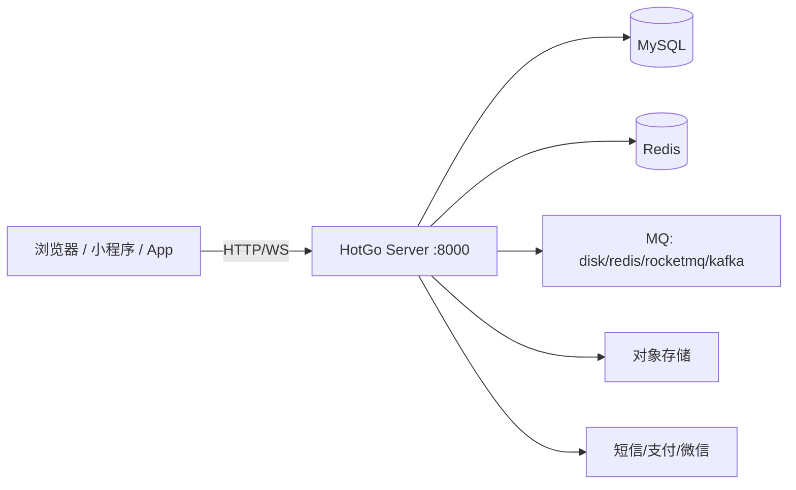

# HotGo V2 项目分析总览

> 本文档是对本仓库（HotGo V2）的**代码级架构分析**，面向二次开发者与架构评审。
> 用户使用手册请见 [`docs/guide-zh-CN/`](../docs/guide-zh-CN/README.md)，开发规范（唯一事实来源）请见 [`AGENTS.md`](../AGENTS.md)。

---

## 1. 项目定位

HotGo 是一个**基于 GoFrame2 + Vue3 + Naive UI 的企业级全栈快速开发框架**，为二次开发而生。

它不是一个业务系统，而是一套"应用开发底座"，核心价值体现在四点：

| 能力 | 说明 |
|------|------|
| 多应用入口 | 一次部署同时提供后台（admin）、前台接口（api）、站点页面（home）、即时通讯（socket）四套入口 |
| 微核插件化 | 插件之间物理隔离、独立微架构，可插拔安装/卸载，可跨项目迁移 |
| 代码生成 | 后台在线选表 → 配置字段 → 一键生成前后端完整 CRUD / 树表代码 |
| 基础设施齐备 | 缓存、队列、存储、短信、支付、TCP 长连接、权限、字典、附件等开箱即用，且均为多驱动可切换 |

**仓库规模**（截至本次分析）：

| 部分 | 规模 |
|------|------|
| 后端 `server/` | 约 780 个文件（697 个 `.go`、42 个 `.template`、10 个 `.sql`、8 个 `.yaml`） |
| 前端 `web/` | 约 502 个文件（247 个 `.ts`、203 个 `.vue`） |
| 文档 `docs/` | 40 个 Markdown + 39 张配图 |
| 其它 | `AGENTS.md`（AI 开发规范）、`README.md`、`LICENSE`(MIT)、`index.html` + `sidebar.md`（docsify 站点） |

> 说明：README 提到 uniapp，但**当前仓库只包含 `docs/`、`server/`、`web/` 三部分**，不含 uniapp 端源码。

---

## 2. 技术栈与版本

### 后端

| 项 | 版本 / 选型 |
|----|------------|
| 语言 | Go 1.24.4（`module hotgo`） |
| 框架 | GoFrame v2 `2.10.0`（gdb / ghttp / gcron / gcache / gerror / gctx / gjson / gvar） |
| 数据库驱动 | MySQL、PostgreSQL（另在生成器侧支持 SQLite 字段解析） |
| Nosql | Redis（`contrib/nosql/redis/v2`） |
| 鉴权 | `golang-jwt/jwt/v5`（HS256）+ `casbin/v2 2.108` |
| 链路追踪 | `contrib/trace/jaeger/v2` + OpenTelemetry |
| 消息队列 | `IBM/sarama`（Kafka）、`apache/rocketmq-client-go/v2`、Redis、磁盘队列 |
| 对象存储 | 阿里云 OSS、腾讯云 COS、UCloud、七牛、MinIO、本地 |
| 支付 | `go-pay/gopay`（支付宝 / 微信 / QQ） |
| 其它 | `excelize/v2`、`base64Captcha`、`gopsutil`（监控）、`selfupdate`（升级）、`gorilla/websocket`、`silenceper/wechat/v2` |

### 前端

| 项 | 版本 / 选型 |
|----|------------|
| 框架 | Vue `3.4.38`（Composition API + `<script setup>`） |
| UI | Naive UI `2.44.1`（唯一 UI 库，禁止引入其它） |
| 构建 | Vite `5.4`、TypeScript `5.5`、pnpm |
| 状态 | Pinia `2.2` |
| 路由 | vue-router `4.4`（hash 模式） |
| 其它 | axios、vue-i18n 11、echarts 5、tailwindcss 3、less、@vueuse/core、lodash-es、Quill、CodeMirror 6 |
| 规范 | ESLint 9（flat config）、Prettier、Stylelint、commitlint、husky + lint-staged |
| 前端版本号 | `package.json` → `2.18.9` |

### 依赖方向



---

## 3. 仓库目录地图

```text
hotgo/
├── AGENTS.md                     # AI/人工开发规范（唯一事实来源，约 34KB）
├── README.md                     # 项目介绍
├── ai/                           # 代码级分析文档（本套：PROJECT_ANALYSIS / ARCHITECTURE-* / MODULES / ADDONS-AND-CODEGEN）
├── index.html / sidebar.md        # docsify 文档站点入口与侧边栏
├── docs/guide-zh-CN/             # 官方中文使用文档（安装、开发、插件、代码生成…）
├── server/                       # 后端（GoFrame v2）
│   ├── main.go                   # 入口：packed → drivers → addons/modules → logic → cmd.Main
│   ├── Makefile                  # build / all / http / queue / cron / dao / service / lint
│   ├── hack/config.yaml          # gf CLI 项目级配置（gen dao / gen ctrl / build）
│   ├── manifest/config/          # config.example.yaml（需复制为 config.yaml）、casbin.conf
│   ├── storage/                  # 9 个初始化 SQL（含表结构与初始数据）
│   ├── api/                      # 对外 HTTP 契约：admin / api / home / websocket / servmsg
│   ├── internal/                 # 主程序内部实现（见第 4 节）
│   ├── addons/                   # 插件：modules/（隐式注册）+ hgexample/（示例插件）
│   ├── resource/                 # 代码生成模板、静态资源、页面模板
│   └── utility/                  # 13 个通用工具包
└── web/                          # 前端（Vue3 + Vite）
    ├── build/                    # Vite 插件、代理、构建后配置注入脚本
    ├── types/                    # 全局类型声明（#/ 别名指向此处）
    ├── vite.config.ts / tsconfig.json / tailwind.config.js ...
    └── src/
        ├── api/                  # 接口封装（与后端模块一一对应）
        ├── components/           # BasicTable / BasicForm / Modal / Upload / Editor ...
        ├── layout/               # 布局骨架（Header / Menu / Main / TagsView）
        ├── router/               # 路由与守卫（后端菜单驱动）
        ├── store/modules/        # Pinia：user / dict / asyncRoute / tabsView / design ...
        ├── utils/                # http(axios 封装) / websocket / dateUtil / hotgo ...
        └── views/                # 页面（与后端业务模块对应，含 addons/ 插件页）
```

---

## 4. 后端 `internal` 分层一览

```text
server/internal/
├── cmd/          # 命令行入口：all / http / queue / cron / auth / tools / up
├── consts/       # 全局常量与字典选项（30 个文件）
├── controller/   # 薄控制器（只做参数透传）→ admin/{admin,common,pay,sys} / api / home / websocket
├── service/      # 服务接口声明（gf gen service 生成）→ ISysXxx / IAdminXxx
├── logic/        # 业务实现 → sys/ admin/ common/ pay/ hook/ middleware/ tcpclient/ tcpserver/ view/
├── dao/          # DAO（gf gen dao 生成，internal/ 为生成产物）
├── model/        # entity / do / input(adminin,sysin,...) / context / response / tree
├── router/       # 手写路由 admin.go api.go home.go websocket.go + genrouter/
├── global/       # 全局初始化、集群同步、路由元数据缓存
├── crons/        # 定时任务注册（init() 注册）
├── queues/       # 消息队列消费者注册（init() 注册）
├── library/      # 22 个基础设施包（addons/cache/casbin/cron/dict/hggen/hgorm/hgrds/...）
├── packed/       # 静态资源打包产物（gf build packDst 目标）
└── websocket/    # WebSocket 运行时（连接管理、消息路由、WsPage）
```

**调用链（严格单向，禁止跨层）**：

```text
api（契约） → controller（透传） → service（接口） → logic（实现） → dao（数据）
```

---

## 5. 核心设计特征

1. **`service` 接口 + `logic` 实现 + `init()` 注册**：所有业务能力通过 `service.RegisterXxx(NewXxx())` 解耦，`main.go` 只匿名导入 `internal/logic` 即可激活全部注册。
2. **多应用入口**：`/admin`、`/api`、`/home`、`/socket` 四组路由共用一套中间件与鉴权体系，前缀全部来自配置 `router.<app>.prefix`。
3. **JWT + Casbin 双层鉴权**：JWT 负责身份，Casbin（策略由 `角色-菜单-权限` 表生成）负责接口级权限。
4. **字典/枚举后端统一维护**：后端 `consts` + `dict` 包注册枚举，前端通过固定接口拉取，禁止前端硬编码枚举值。
5. **插件化微核**：插件拥有与主模块镜像的完整目录结构与独立 service 包，通过 `addons/modules/*.go` 隐式注册，安装态由 `hg_sys_addons_install` 表驱动。
6. **代码生成即框架的一部分**：`internal/library/hggen` 内嵌 GoFrame CLI（gen dao/service/ctrl）并叠加模板渲染，支持在线生成 CURD/树表代码并可直接落到插件目录。
7. **基础设施全部多驱动**：缓存 3 种、队列 4 种、存储 6 种、短信 2 种、支付 3 通道，配置化切换。
8. **前端路由完全由后端菜单驱动**：`permissionMode: 'BACK'`，`src/router/modules` 为空，页面路由来自 `/role/dynamic` 返回的菜单树。

---

## 6. 快速上手

### 后端

```bash
# 1. 准备配置
cd server
cp manifest/config/config.example.yaml manifest/config/config.yaml   # 改数据库/Redis/端口

# 2. 初始化数据库
#    导入 storage/*.sql（先建库 hotgo，表前缀 hg_）

# 3. 启动（默认同时拉起 http + queue + cron）
go run main.go            # 等价于 main.go all
go run main.go http       # 仅 HTTP
go run main.go cron       # 仅定时任务
go run main.go queue      # 仅消息队列
```

常用 Makefile 目标：`make all|http|queue|cron`（`gf run` 热编译）、`make dao`（`gf gen dao`）、`make service`（`gf gen service`）、`make build`（编译前端 → 打包资源 → `gf build`）、`make refresh`（刷新 casbin 权限）。

### 前端

```bash
cd web
pnpm install
pnpm dev        # 默认 8001，代理 /admin → http://localhost:8000/admin
pnpm build      # 产物 dist/，并生成 app.config.js（运行期可改配置）
```

默认账号：`admin / 123456`（演示站口径）。

---

## 7. 文档导航

| 文档 | 内容 |
|------|------|
| [PROJECT_ANALYSIS.md](PROJECT_ANALYSIS.md) | 本文件：项目定位、技术栈、目录地图、核心特征、快速上手 |
| [ARCHITECTURE-BACKEND.md](ARCHITECTURE-BACKEND.md) | 后端详解：启动流程、配置、分层、中间件与鉴权、路由、cron/queue、基础设施库、工具包 |
| [ARCHITECTURE-FRONTEND.md](ARCHITECTURE-FRONTEND.md) | 前端详解：工程化、路由、状态、HTTP 封装、组件体系、页面模式、字典、权限、WebSocket |
| [MODULES.md](MODULES.md) | 业务模块地图：后端模块 ↔ service ↔ 前端页面 ↔ API 对照 |
| [ADDONS-AND-CODEGEN.md](ADDONS-AND-CODEGEN.md) | 插件体系、代码生成器、新增插件/模块的流程与约束 |
| [`AGENTS.md`](../AGENTS.md) | 开发规范（新增代码必须对齐，唯一事实来源） |
| [`docs/guide-zh-CN/`](../docs/guide-zh-CN/README.md) | 官方使用手册（安装、部署、开发、插件、生成代码、SaaS 多租户等） |

---

## 8. 分析结论与建议

### 优势

- **分层清晰、约束明确**：`api → controller → service → logic → dao` 单向依赖，`service` 接口化使模块可替换、可测试。
- **注册式扩展**：`init()` 注册 + 匿名导入激活（logic / crons / queues / 插件模块），新增能力不需要改动框架核心代码。
- **插件隔离度真实**：独立目录、独立 service 包、独立路由前缀、独立配置分组，且用 `hg_sys_addons_install` 控制启停。
- **生成器覆盖主干场景**：CURD 与树表生成质量高，且模板支持"生成到插件目录"（`isAddon`），显著降低重复劳动。

### 需要注意 / 可改进点

1. **代码生成类型未全实现**：`consts/gencodes.go` 中 `Queue(20)` / `Cron(30)` 在 `hggen.Preview/Build` 仍返回"开发中/暂不支持"，README 宣传的"队列、定时任务一键生成"当前不可用。
2. **生成过程无进度反馈**：`hggen` 为同步一次性请求，无 WebSocket 进度推送，大表生成时前端只能 loading。
3. **配置样例与运行时分离**：仓库只提供 `config.example.yaml`，首次运行必须手动复制，否则启动失败（建议补充启动期友好提示或 Makefile 自动复制）。
4. **前端历史遗留**：`src/router/modules` 目录不存在（`asyncRoutes` 恒为空）、`store/modules/index.ts` 引用了不存在的文件名、`utils/hotgo.ts` 中 `getOptionLabel/getOptionTag` 已 `@deprecated` 但仍在用，建议逐步清理。
5. **前后端枚举存在双份定义**：后端 `consts` 注册字典，前端 `src/enums/localDictEnum.ts` 又维护了一份本地字典（`noticeTypeOptions` 等），需注意二者同步。
6. **`internal/library/debris`** 为空占位包，建议删除以免误导。
7. **文档双轨**：`docs/guide-zh-CN/`（使用手册）与 `AGENTS.md`（开发规范）内容存在重叠，维护时需同步更新。
